<div align="center">

**English** | [中文](README.md) | [日本語](README_ja.md)

</div>

<p align="center">
  
</p>

<h1 align="center">Pagekin</h1>

<p align="center"><sub>Formerly “AI Novel Writer” (AI 小说作家). Chinese name: 书童, “the scholar’s page”.</sub></p>

<p align="center">
  <strong>Pagekin is a free, open-source AI novel writing app for Windows and macOS, for authors who want to write a long novel with AI.</strong><br />
  Go from setup, story architecture, characters, and chapter blueprints to drafting, review, revision, and final chapters, one chapter at a time. You can also break down a reference novel to imitate its style, import your manuscript and continue it, or rewrite to your own notes.<br />
  Local-first: your books stay on your own computer. No model is bundled: use your own API key (DeepSeek, OpenAI, Gemini, Zhipu, and others), or run a local model with Ollama.
</p>

Pagekin is maintained by EthanYoQ and is open source under GPL-3.0. The [official website](https://www.orz.md/en/ai-novel-writer/) provides the product overview, setup guide, and official download links.

<p align="center">
  <a href="https://github.com/EthanYoQ/Pagekin/releases/latest"></a><br />
  <a href="https://www.orz.md/en/ai-novel-writer/#demo">English first-use guide with real screenshots</a><br />
  <sub>Manual project setup. Bring your own local or cloud model.</sub>
</p>

<p align="center">
  <a href="https://github.com/EthanYoQ/Pagekin/releases"></a>
  <a href="https://github.com/EthanYoQ/Pagekin/blob/master/LICENSE"></a>
  <a href="https://github.com/EthanYoQ/Pagekin/stargazers"></a>
</p>

<p align="center">
  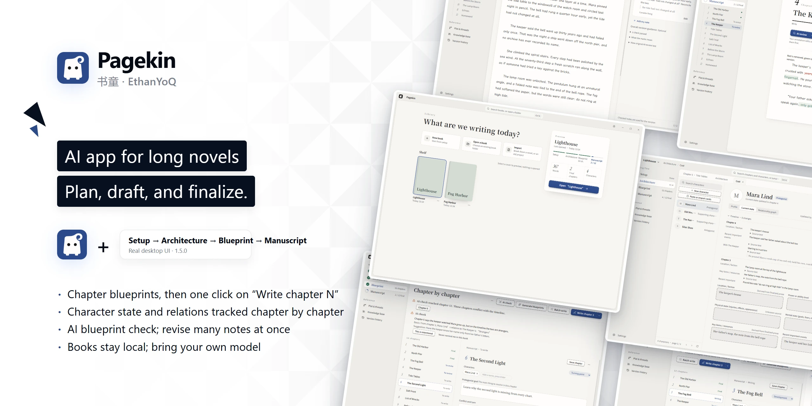
</p>

> ## What's new in 1.5.0
>
> - **Trash**: when you choose "Delete manuscript…" on a finalized chapter, its text and all its versions go to the trash, and you can restore them. After you delete a chapter in the middle, the rest of the book stays writable.
> - **Reopen to edit**: reopen a finalized chapter. Before you finalize it again, Pagekin lists how the change affects later chapters, and then the AI can check later blueprints.
> - **Character timeline**: each character records state and relationship changes chapter by chapter. When you write chapter N, the AI gets the characters as they are at chapter N.
> - **Story-thread reminders**: threads have due chapters. When you reach them, the threads to handle become this chapter's tasks in the drafting prompt, and review checks them.
> - **Blueprint AI check**: checks unfinalized blueprints against the character timeline for reversed relationships or characters who have died.
> - **Revise all annotations**: annotate many passages in a chapter, send them to the model together, and accept each change.
> - **Japanese interface (phase 1)**, the Anthropic protocol, an optional reranking model for the knowledge base, and notifications when work finishes in the background.
>
> See the [1.5.0 release notes](https://github.com/EthanYoQ/Pagekin/releases/tag/v1.5.0) for details.

## What it does

Pagekin works in the order a novel gets written: you are the author, it is your page. Each step is saved in the book and feeds the next one. AI drafts, and you confirm every step.

### Library: all your books in one place

The library lists every book you have written. Select a cover to preview it: the current step, word count, final chapters, and characters. You can start a new book or import a copy of a project from an older version.

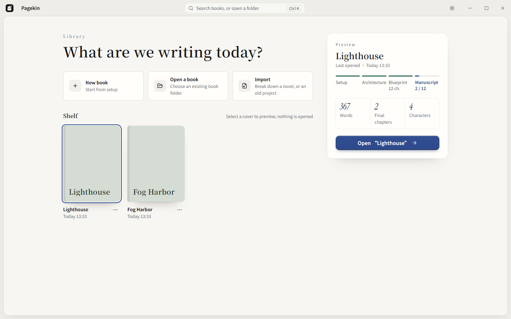

### Breakdown, imitation, continuation, and rewriting

"Novel breakdown & imitation" in the library imports a novel as a .txt, .md, or .epub file, splits it into chapters, and asks what the text is for.

- **Breakdown and imitation**: choose "Reference novel". AI breaks down its structure, extracts its style, infers chapter blueprints, and produces imitation constraints for your later writing. A reference novel goes only into the knowledge base and the breakdown. It never mixes into your prose.
- **Continue your manuscript**: choose "My manuscript". The chapters you already wrote are imported by chapter number as finalized text, and AI continues the following chapters from those characters and events. You can also select "Also infer settings, architecture, characters, and blueprints". Blueprints are inferred only for chapters that have none. Other inference only fills empty fields, and results that differ from your content appear as suggestions you adopt one at a time. If an import stops, "Continue import" finishes it without redoing committed batches.
- **Continue a passage**: select text in the prose editor and choose Continue on the toolbar. AI writes on from that passage.
- **Rewrite**: to rewrite a whole chapter, use Revise. Write the direction you want, optionally check review notes, and compare the result with the original paragraph by paragraph to choose which version to keep. For a short passage, select it and use Refine, Expand, To dialogue, or "Revise with note" with your own instruction.

### Setup and architecture: build the story first

The setup page records the genre, audience, writing language, total chapters, and words per chapter. The architecture page has four sections: premise, cast, worldbuilding, and plot outline. AI can generate each section, or you can write it yourself. When all four are confirmed, move on to chapter blueprints.

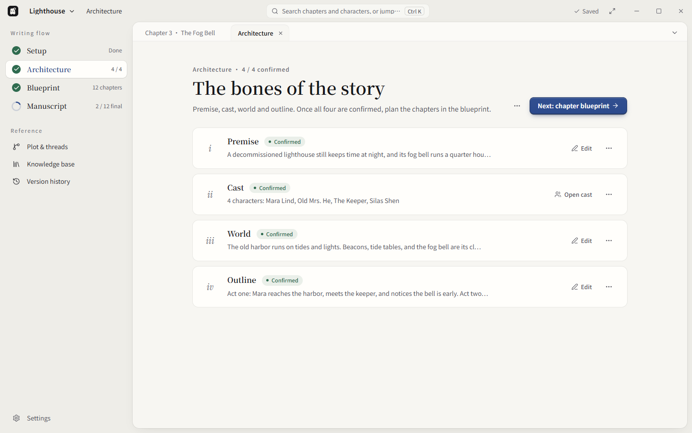

The cast is edited alongside the architecture. Each character has a profile, a current state, and a relationship graph. You can paste character cards or import them from a file.

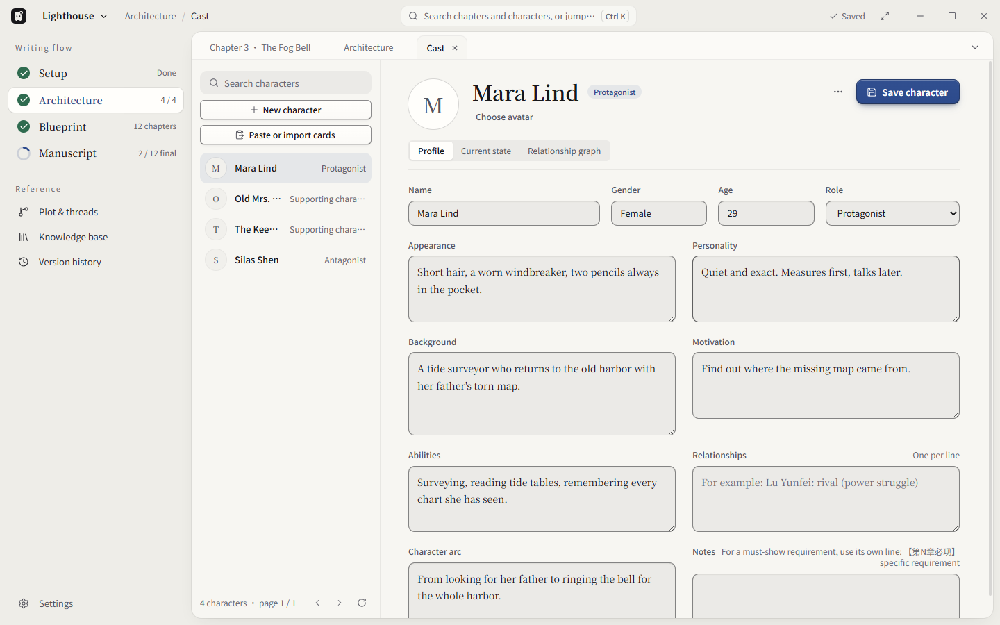

### Character timeline: characters as they are at chapter N

Above a character's current state, the cast page shows "Timeline · N changes". Expand it to see each chapter's state and relationship changes with their source. For changes recorded from a final, you can read the quoted text. When you edit a state by hand, you can choose the chapter it takes effect from.

- When you write or rewrite chapter N, the prompt uses character states and relationships from the timeline at chapter N, not the latest values. If you go back and fill in an earlier chapter, characters do not know what happens later.
- Finalization records relationship changes in the same request, with no extra requests. When a change differs from your setting, a pending suggestion offers Adopt, Keep my setting, and Decide later.
- New characters and relationships that the model proposes while it generates blueprints also become pending suggestions. You create each one, match it to an existing character, or skip it.

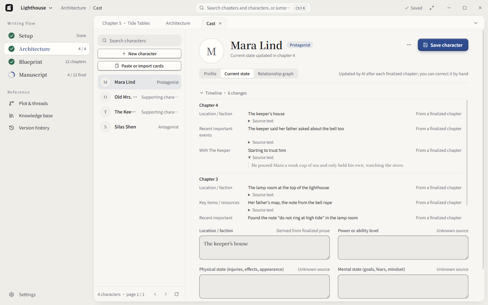

### Chapter blueprints: plan each chapter before writing

The blueprint page plans the book chapter by chapter. Each chapter states the protagonist's goal, the conflict and turn, the suspense hook, and the characters who appear. AI can generate blueprints in chapter ranges, and an interrupted run can continue.

The main button is "Write chapter N". The small popover next to it holds only the options for this run: which model to use and an optional line of author guidance. To write several chapters in a row, use "Batch write", up to 10 chapters at a time.

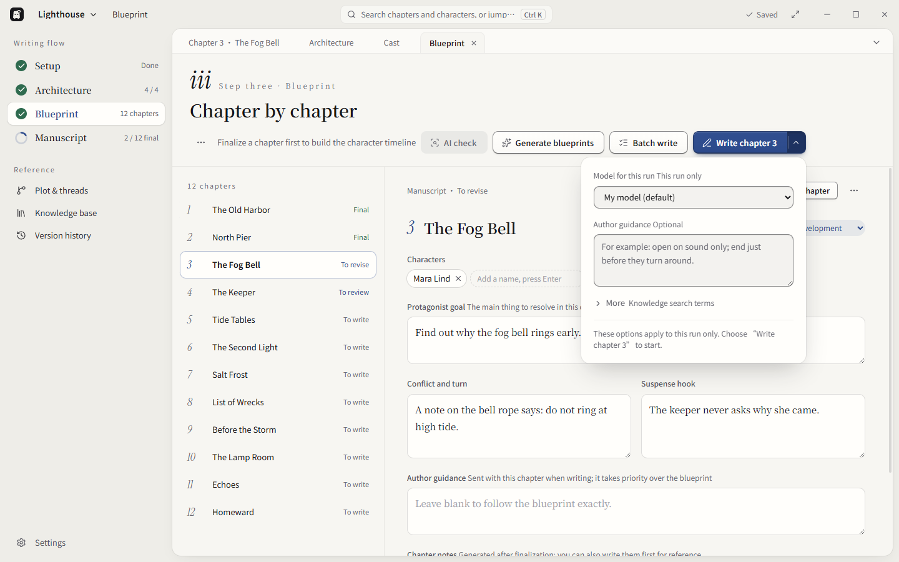

Blueprints get two checks. Neither one blocks writing.

- **Notice on save**: when an AI-generated blueprint has two characters whose relationship contradicts the timeline, or includes a character who has died, the Blueprint page shows a notice with its basis. Select "This is intentional" to exempt one chapter or the whole book.
- **AI check**: each click sends one model request that checks unfinalized blueprints against the character timeline and lists the results by chapter. It needs a character timeline and saved blueprints. In a long book whose unfinalized blueprints do not fit in one request, only the earlier chapters are checked, and the result names the last one ("Checked through chapter N" or "AI check reached chapter N").

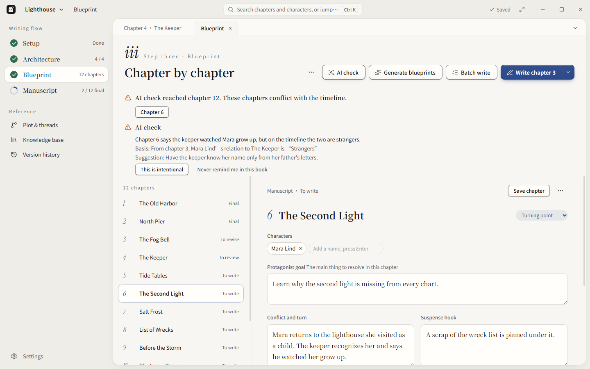

### Story threads: reminders by due chapter

The Plot & threads page records where the main plot, subplots, and foreshadowing are planted, advanced, or resolved, chapter by chapter.

- When you write a chapter, Pagekin picks this chapter's tasks from due, overdue, and assigned threads. The prompt marks whether each one is overdue, and review checks them.
- The write popover shows "N threads to handle here". You can move a thread on by 1 or 3 chapters and undo it, or advance a thread that is not due yet.
- When review finds that a chapter resolved a thread, select "Confirm resolved" after finalization to record it. The thread page marks threads whose payoff chapter is beyond the planned chapter count.

### Manuscript: draft, review, revise, finalize

The single-chapter view takes a chapter from unwritten to final. After AI writes a draft, you can edit it yourself or ask AI to review it. The review report lists each note. You check or ignore each one, and you can add your own. The revision comes back as a diff that you confirm paragraph by paragraph, so nothing is overwritten. When it reads right, finalize the chapter.

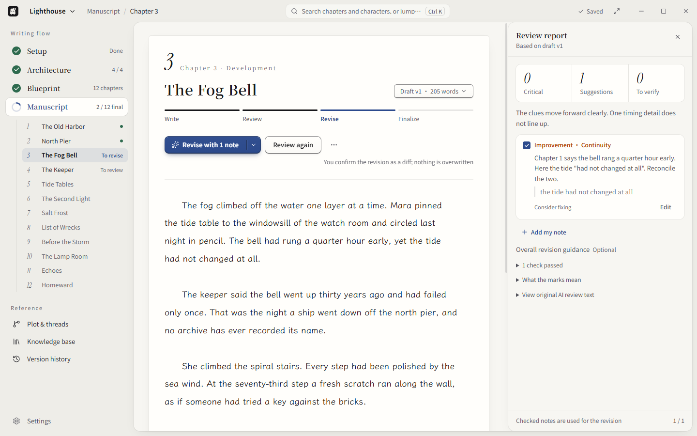

While writing, AI receives this chapter's blueprint, the related characters, the worldbuilding, summaries of earlier chapters, the full previous chapter, and the threads this chapter should handle, not a chat transcript of the whole book.

- **Revise all annotations**: select text and choose "Add annotation". After you annotate several passages, select "Revise all (N)" to send them to the model together. Removed text shows in red and added text in green. You can edit, regenerate, or accept each change, or choose "Accept all". The chapter page keeps the annotation history.
- **Keyboard writing**: Tab inserts two full-width spaces as a paragraph indent, and a whole chapter can be written with the keyboard alone. Ctrl/⌘+F searches the chapter.

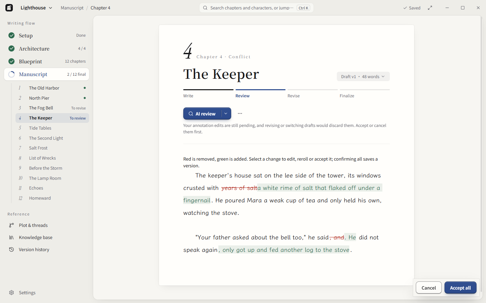

### Post-processing, Reopen to edit, and Trash

After each chapter is finalized, Pagekin imports the final text into the knowledge base, generates chapter notes, and updates character states and relationships. If post-processing fails or is cancelled, the final text is already saved, and you can retry the unfinished steps.

- **Reopen to edit**: on a finalized chapter, select "Reopen to edit". The current final is copied into a reopened draft that you edit, review, and revise as usual. The finalize dialog first lists how the replacement affects later chapters, character states, and thread confirmations. The old final stays in version history as "Replaced final", read-only.
- **Check later blueprints**: after a replacement, the AI suggests changes for later unfinalized chapters, with the basis and a before-and-after view. You choose Accept or Don't use for each one. It changes blueprints only, never chapter text.
- **Trash**: when you choose "Delete manuscript…" on a finalized chapter, its text and all its versions go to the trash, where you can Restore or Delete permanently. "Delete chapter…" on a blueprint and "Delete this draft…" on a draft skip the trash and cannot be undone. After you delete a chapter in the middle, you can use "Rewrite chapter N" to write it again in place.

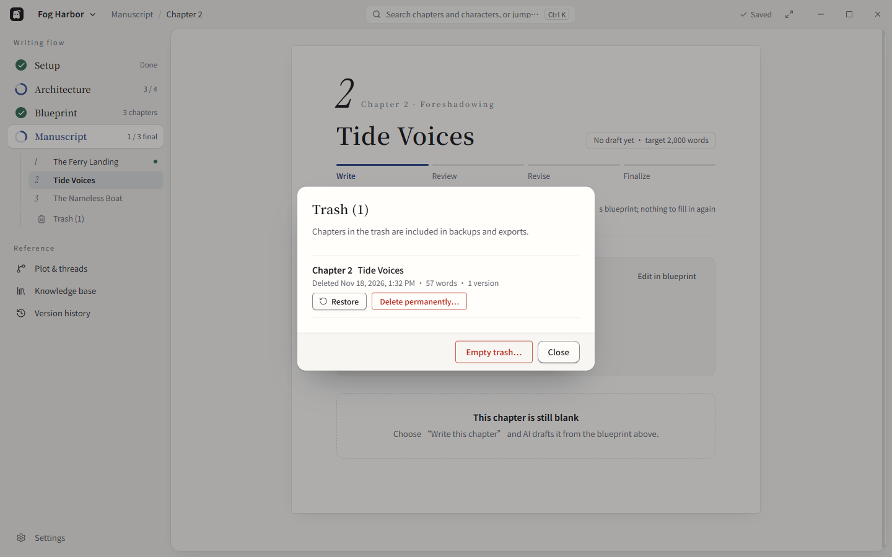

### Knowledge base and search: reference material while drafting

- Import reference material (.txt, .md). Final chapters go into the knowledge base during post-processing.
- With an embedding model, search is semantic. The embedding model is the one under Settings → Retrieval model. If none is set and the default model supports embeddings (including an older profile with no purposes recorded), Pagekin uses the default model. With neither, search is local full-text search, and Chinese queries are split into words so passages with only some of the words still match.
- Under Settings → Retrieval model, you can add an optional reranking model. Search then collects more passages, reranks them, and keeps the most relevant ones. If reranking fails, results keep their original order.
- When you fill in a chapter in the middle, search does not return final text from that chapter or later ones, so the draft does not borrow later plot.

### Run sheet: see what AI is doing

Every generation run appears in the run sheet, with In progress, History, and Diagnostics tabs. You can watch the output as it is written and cancel at any time. A batch can be paused. When a step makes no progress for 15 seconds, its card shows how long it has waited.

If a run fails, the text written so far is kept as a recovery card that you can adopt, copy, or dismiss. When Pagekin is in the background, it shows a system notification when writing, review, revision, finalization, or batch writing ends. Turn this off with "Notify me in the background" under Settings → Appearance.

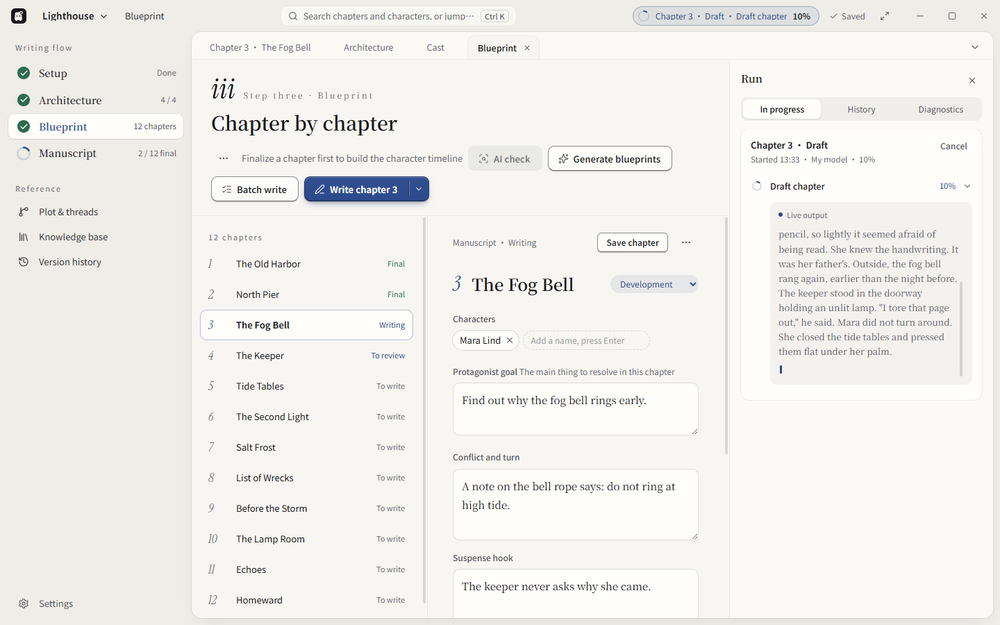

### Versions, export, and backup

- **Version history**: every past version of a chapter is kept. Compare it with the current draft, or restore it as a new draft.
- **Export**: merged Markdown, one Markdown file per chapter, or plain text.
- **Backup**: archive a book on your computer or back it up to a WebDAV cloud you connect. Restoring always creates a new copy.

### Writing skills: bring your own writing rules

On the "Writing skills" settings page, choose a local skill folder or a single SKILL.md, or enter the address of a skill on GitHub, to import a prompt-only writing skill, such as one that removes the typical AI tone, or one for a particular style or genre. Reference text files that SKILL.md cites are included. The app reads the skill and shows you its content before you install it. Bind it to the planning, drafting, review, or revision stage, and every generation in that stage includes it.

Only self-contained SKILL.md prompts are supported. Scripts, hooks, subagents, and tool requirements are not installed, so a skill cannot run code on your computer.

### Dark theme and three interface languages

Appearance offers light and dark. The interface is available in Chinese, English, and Japanese. The Japanese interface is in phase 1: the interface frame and error messages are in Japanese, and other text stays in English. A book's writing language can be Chinese or English.

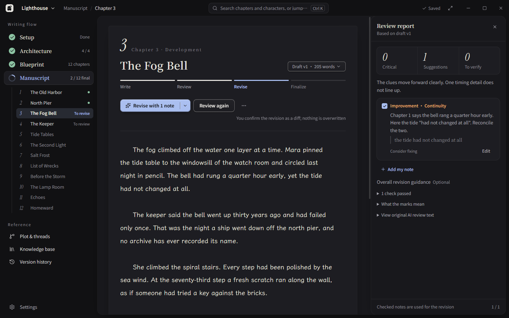

## How it differs from writing a novel in an AI chat

When you write a long novel in a chat window, the usual problems are contradictions, forgotten foreshadowing, and later chapters that break after you edit an earlier one. Pagekin keeps this in the book's data instead of in a conversation that keeps growing.

- **Context is built per chapter**: each chapter gets the blueprint, characters, worldbuilding, earlier summaries, previous chapter, and threads it needs. The whole book never has to fit in one conversation.
- **Character states follow the chapter**: chapter N uses the states and relationships as of chapter N, so filling in an earlier chapter does not leak later events.
- **Threads have due dates**: the threads this chapter should handle go into the prompt, review checks them, and you confirm when one is resolved.
- **Edits come with an impact list**: before a final is replaced, Pagekin lists what it affects, and the AI can then revise only the later blueprints.
- **AI never overwrites your text directly**: revisions, annotation edits, inferred settings, and relationship changes appear as diffs or suggestions for you to accept.
- **Your books stay local, and you pick the model**: data lives in a local SQLite database and your book folder. The model can be a cloud API or a local model.

## Supported models and services

Pagekin does not provide models or host quotas. In settings, enter your own service address, model name, and API key. Three request protocols are supported:

- **OpenAI-compatible**: any service compatible with the Chat Completions API.
- **Native Gemini**: Google Gemini.
- **Anthropic**: services compatible with the Messages API, such as Zhipu's Anthropic endpoint.

Settings include presets for these providers:

| Provider | Protocol | Notes |
| --- | --- | --- |
| DeepSeek | OpenAI-compatible | Preset address `https://api.deepseek.com` |
| SiliconFlow | OpenAI-compatible | Preset address `https://api.siliconflow.cn/v1` |
| BigModel (Zhipu) | OpenAI-compatible | Preset address `https://open.bigmodel.cn/api/paas/v4` |
| BigModel (Zhipu Anthropic) | Anthropic | Preset address `https://open.bigmodel.cn/api/anthropic` |
| OpenAI | OpenAI-compatible | Preset address `https://api.openai.com` |
| xAI (Grok) | OpenAI-compatible | Preset address `https://api.x.ai/v1` |
| Google Gemini | Native Gemini | Preset address `https://generativelanguage.googleapis.com` |
| Ollama (local) | OpenAI-compatible | The model runs on your own computer |
| NovelAI | OpenAI-compatible | Minimal compatibility, not fully verified with a real account |
| Custom | Any of the three | Any compatible service address |

"Custom" only changes the address, model name, and credentials within the three protocols above. It is not an arbitrary HTTP interface. Azure, native KoboldAI, and similar interfaces need dedicated adapters, and a URL swap does not make them work.

- **Model list**: after you enter the address and API key, Pagekin fetches the endpoint's model list. You can also type any model name, including a local model file path (for example with llama.cpp).
- **Context window**: when you select a model, the context window fills in with its source (from provider, built-in data, default, set by you, or measured). When you write a single chapter and the provider rejects it as too long, Pagekin writes it again once if it can read the real window from the error. It saves that window and trims reference material first.
- **Models by stage**: under Settings → Advanced → Models by stage, assign a model to planning, drafting, review, revision, and post-processing. Stages without one use the default model.
- **Retrieval model**: semantic search in the knowledge base needs a model that supports embeddings. You can set one under "Retrieval model" in settings. Without one, a default model that supports embeddings is used instead. A reranking model is optional.

### Run a local model with Ollama

```text
Provider:  Ollama (local) or Custom
Protocol:  OpenAI-compatible
Base URL:  http://127.0.0.1:11434/v1
API key:   may be left blank; if the UI requires one, use any placeholder
Model:     your Ollama model name, for example qwen3:14b
```

Embedding models also use the `/v1` address. Do not use `http://127.0.0.1:11434/api`, which is Ollama's native interface.

## Download and install

Download official installers only from [GitHub Releases](https://github.com/EthanYoQ/Pagekin/releases/latest).

System requirements: Windows x64, or macOS (separate installers for Apple Silicon and Intel). You also need a model service: a cloud API key, or a local inference service such as Ollama.

### Windows x64

```text
ai-novel-writer-setup-<version>.exe
```

1. Run the installer. An upgrade updates only the application and does not delete books, character cards, or settings. Back up important work first anyway.
2. After installation, check for updates under "Settings → About & updates". A new version is announced first. It downloads only after you choose "Download update", and when it finishes you choose to restart now or later.
3. Older portable ZIP builds cannot get the updater automatically. Install an official installer manually once.

The installer is not code-signed at present. Windows may show an unknown-publisher warning. Continue only after confirming that the download page is this repository's official GitHub Release.

### macOS (Apple Silicon and Intel)

```text
ai-novel-writer-mac-arm64-<version>-installer.dmg
ai-novel-writer-mac-x64-<version>-installer.dmg
```

1. `arm64` is for Apple Silicon Macs (M1, M2, M3, M4, and later). `x64` is for Intel Macs.
2. Drag the app from the DMG to Applications and launch it. The app announces new versions but does not download or replace itself on macOS. Updating opens the official Release page so you can download the installer for your architecture.
3. Both installers are ad-hoc signed, have no Developer ID signature, and are not notarized. If Gatekeeper blocks the app, confirm that it came from this repository's official GitHub Release, then Control-click the app in Finder and choose "Open", or allow it in "System Settings → Privacy & Security".

## Data and privacy

| Data or behavior | Location or destination |
| --- | --- |
| Books, characters, blueprints, drafts, and final chapters | Your book folder and a local SQLite database. |
| Finalized chapters deleted with "Delete manuscript…" | The current book's trash. You can restore them until you delete them permanently. |
| Recovery cards from failed runs | Only in the current book's local database. They never become drafts or final chapters on their own. |
| Imported reference material | Stored in the local book. With an embedding model (including the default model as a fallback), its passages are sent to that model during import. |
| Local model requests | Sent to the local or LAN inference service you configure. |
| Cloud model requests | Prompts and context go to the provider you choose. |
| Knowledge-base import and search | With an embedding model (including the default model as a fallback), passages from imported material and final chapters, and search queries, go to that model. With a reranking model, queries and the retrieved passages go to the reranking model. Without either, search stays local. |
| Model settings and API keys | Stored in the `ai-novel-writer` folder of your app data directory (`%APPDATA%\ai-novel-writer` on Windows, `~/Library/Application Support/ai-novel-writer` on macOS). Protect your OS account and do not share this folder. |
| App preferences | Stored in the same folder as the model settings. |

Earlier versions kept settings in `~/.vela`. The current version copies them to the folder above at startup and leaves the original untouched.

The app does not provide model accounts, cloud generation, or promotional messages. Update checks read public GitHub Releases only.

## FAQ

### Is Pagekin free?

Yes. It is open source under the GPL-3.0 license. Any cost of calling a cloud model is between you and the model provider. A local model through Ollama needs no provider at all.

### Which AI models can I use to write a novel?

Any model behind an OpenAI-compatible Chat Completions API works, such as DeepSeek, Qwen (through SiliconFlow), Zhipu GLM, OpenAI, and xAI Grok. Google Gemini uses its native protocol, and Zhipu's Anthropic endpoint uses the Anthropic protocol. For local models, use Ollama. Output quality depends on the model you choose. The app makes no promise about model output.

### Where is my data stored? Is it uploaded?

On your own computer: the book folder plus a local SQLite database. Operations that use a model, such as drafting, review, and the breakdown and post-processing after a novel import, send the relevant text, setup, and context to the model service you configured. With an embedding model (including the default model as a fallback), knowledge-base import sends passages of your material to it, and search sends the query. With a reranking model, search sends the query and the retrieved passages to it. To keep private material local, before you import, switch every model the import uses to a local one: the default model, any models under Models by stage, and the retrieval and reranking models. If no retrieval model is set, the default model fills in. WebDAV backup uploads only after you connect WebDAV and start a backup.

### Can I write offline?

Yes, if every model you use is on your computer or LAN, including the default model, any models under Models by stage, and the retrieval and reranking models. Update checks, importing skills from GitHub, WebDAV backup, and cloud models need a network connection.

### How long can a novel be? Will it stay consistent?

You set the total number of chapters, with no fixed limit. For each chapter, AI receives the chapter's blueprint, the related characters, the worldbuilding, summaries of earlier chapters, the full previous chapter, and the threads it should handle, so the whole book never has to fit in one conversation. Character states follow the chapter, and the blueprint AI check compares blueprints with the character timeline. Batch write handles up to 10 chapters per run, and you can keep going run after run.

### Can I edit a finalized chapter? What if I delete the wrong chapter?

Yes. Select "Reopen to edit" on a finalized chapter. When you finalize it again, it replaces the old final, which stays in version history. Finalized chapters deleted with "Delete manuscript…" go to the trash, and you can restore them.

### Can I import a novel I already started and continue it?

Yes. In the library, open "Novel breakdown & imitation", import a .txt, .md, or .epub file, and choose "My manuscript". Your chapters are imported as finals, settings, architecture, characters, and blueprints can be inferred from them, and you continue from the next chapter.

### Does it support writing in English or Japanese?

A book's writing language can be Chinese or English. Japanese writing is not supported yet. The interface is available in Chinese, English, and Japanese, and the Japanese interface is in phase 1.

### How do I upgrade to 1.5.0?

If you have 1.1.0, 1.2.x, 1.3.x, or 1.4.x installed, you get an in-app update notice (on macOS, download the new installer by hand). When 1.5.0 opens a project, it upgrades the project data. After that, 1.4.x and earlier cannot open the project or restore archives exported from 1.5.0, so back up important books first. For a project from an older version, choose "Import" in the library and then "Import an old project copy". Importing creates a new copy and leaves the original project untouched.

### Can I import skills, such as one that removes the AI tone?

Yes. On the "Writing skills" settings page, choose a local skill folder or SKILL.md, or enter the skill's GitHub address, review its content, install it, and bind it to a stage such as drafting or revision. Only prompt-only SKILL.md files are supported. No scripts are installed or run.

### Where did the assistant chat go?

The interface introduced in 1.3.0 hides the assistant chat entry for now. It will return separately. Drafting, review, revision, and the rest of the workflow are unaffected.

### Windows or macOS says the installer is unsafe. What should I do?

The Windows installer is unsigned, and the Mac installers are only ad-hoc signed and not notarized by Apple, so the system warns you. After confirming the installer came from this repository's official GitHub Release, follow the steps under "Download and install" to allow it.

## Current limits

- A URL and key alone do not guarantee that any third-party API works. Only the three implemented protocols and the presets are supported.
- The writing language is Chinese or English. The Japanese interface translates only the interface frame and error messages.
- The app does not replace your creative judgment, fact checking, or copyright decisions. Review everything AI writes.
- It does not offer online publishing, a reading community, or cloud model accounts.

## Build from source

You need Node.js 22.14 or later and the pnpm version pinned in the repository.

```sh
git clone https://github.com/EthanYoQ/Pagekin.git
cd Pagekin
pnpm install --frozen-lockfile
pnpm dev
```

Official installers are built in GitHub Actions. The Windows x64, macOS Apple Silicon, and macOS Intel installers each pass their own qualification before they are listed in one GitHub Release. See [`docs/README.md`](docs/README.md) for documentation authority, ADRs, and development rules. The logo, colors, and design files are indexed in the [brand kit](docs/brand/README.md) (in Chinese).

## Contributing

Report bugs and request features in [GitHub Issues](https://github.com/EthanYoQ/Pagekin/issues), and ask usage questions in [Discussions](https://github.com/EthanYoQ/Pagekin/discussions). Read [CONTRIBUTING.md](CONTRIBUTING.md) before opening a pull request. This is a public repository, so remove API keys, full novel text, and local paths from anything you submit.

## DeepSeek Harness plugin (frozen)

The repository also keeps the `@ethanyoq/dsh-ai-novel-writer` `0.1.0` developer preview, a Web plugin for DeepSeek Harness. The plugin is frozen, with no short-term feature work planned. It has less than 10% of the desktop application's capabilities, does not read desktop projects, and does not replace the desktop app. It is published separately on [npm](https://www.npmjs.com/package/@ethanyoq/dsh-ai-novel-writer) under the MIT license. See the [plugin README](plugins/dsh-ai-novel-writer/README.md) for installation and use.

## License

The desktop application is open source under the [GPL-3.0](LICENSE) license.
