<div align="center">

[English](README_en.md) | [中文](README.md) | **日本語**

</div>

<p align="center">
  
</p>

<h1 align="center">Pagekin</h1>

<p align="center"><sub>旧名「AI Novel Writer」（AI 小说作家）。中国語名は 书童（「書生に仕える小姓」の意）です。</sub></p>

<p align="center">
  <strong>Pagekin は、AI で長編小説を書くための無料・オープンソースのデスクトップアプリです。Windows と macOS に対応しています。</strong><br />
  設定、ストーリー構成、キャラクター、章ブループリントから、下書き、レビュー、推敲、確定稿まで、1 章ずつ書き進められます。参考小説を分解してその文体を模倣したり、自分の原稿をインポートして続きを書いたり、自分の指示どおりに書き直したりすることもできます。<br />
  ローカルファースト：作品はあなた自身のコンピューターに保存されます。モデルは同梱していません。ご自身の API キー（DeepSeek、OpenAI、Gemini、Zhipu など）を使うか、Ollama でローカルモデルを実行してください。執筆言語は中国語と英語です。
</p>

Pagekin は EthanYoQ がメンテナンスしており、GPL-3.0 のオープンソースです。[公式サイト](https://www.orz.md/en/ai-novel-writer/)では、製品概要、セットアップガイド、公式ダウンロードリンクを提供しています。

<p align="center">
  <a href="https://github.com/EthanYoQ/Pagekin/releases/latest"></a><br />
  <a href="https://www.orz.md/en/ai-novel-writer/#demo">実際のスクリーンショット付きの英語版初回利用ガイド</a><br />
  <sub>プロジェクトは手動でセットアップします。ローカルまたはクラウドのモデルはご自身で用意してください。</sub>
</p>

<p align="center">
  <a href="https://github.com/EthanYoQ/Pagekin/releases"></a>
  <a href="https://github.com/EthanYoQ/Pagekin/blob/master/LICENSE"></a>
  <a href="https://github.com/EthanYoQ/Pagekin/stargazers"></a>
</p>

<p align="center">
  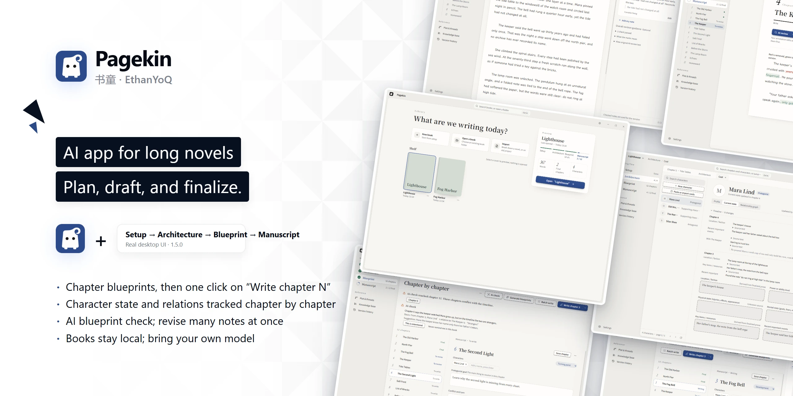
</p>

> ## 1.5.0 の新機能
>
> - **ゴミ箱**：確定済みの章で「Delete manuscript…」を選ぶと、本文とすべてのバージョンがゴミ箱に入り、復元できます。途中の章を削除しても、本の残りはそのまま書き続けられます。
> - **確定稿の再編集（Reopen to edit）**：確定した章を開き直して修正できます。再確定の前に後続の章への影響を一覧表示し、その後 AI に後続のブループリントを確認させることができます。
> - **人物の状態と関係のタイムライン**：キャラクターごとに、章単位で状態と関係の変化を記録します。第 N 章を書くとき、AI には第 N 章時点の人物の状態が渡されます。
> - **伏線の期限リマインダー**：伏線には期限の章があります。その章になると、扱うべき伏線がその章のタスクとして執筆プロンプトに入り、レビューで確認されます。
> - **ブループリントの AI チェック**：未確定の章のブループリントを人物のタイムラインと照合し、関係の矛盾や死亡したキャラクターの登場を見つけます。
> - **注釈の一括修正**：章の複数の箇所に注釈を付け、まとめてモデルに修正させ、1 か所ずつ採用できます。
> - **日本語インターフェース（第 1 段階）**、Anthropic プロトコル、ナレッジベースのリランキングモデル、バックグラウンドでの完了通知。
>
> 詳しくは [1.5.0 のリリースノート](https://github.com/EthanYoQ/Pagekin/releases/tag/v1.5.0)をご覧ください。

## できること

Pagekin は、小説が書かれる順序に沿って動作します。あなたが作者で、Pagekin はあなたに仕える小姓です。各ステップは本の中に保存され、次のステップに引き継がれます。AI が下書きを作り、あなたがすべてのステップを確認します。

日本語インターフェースは第 1 段階のため、ボタン名の多くは英語のままです。以下ではアプリに表示される英語の名前で書いています。

### ライブラリ：すべての本を 1 か所に

ライブラリには、あなたが書いたすべての本が一覧表示されます。表紙を選ぶと、現在のステップ、文字数、確定済みの章、登場人物をプレビューできます。新しい本を始めたり、旧バージョンのプロジェクトのコピーをインポートしたりできます。

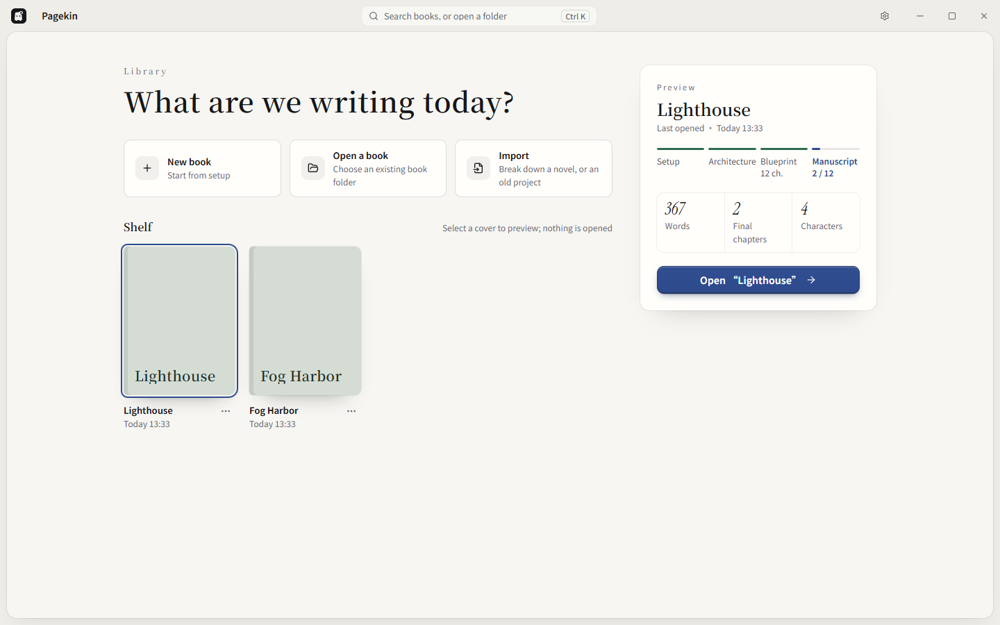

### 分解、模倣、続き書き、書き直し

ライブラリの「Novel breakdown & imitation」では、小説を .txt、.md、.epub ファイルとしてインポートし、章ごとに分割して、そのテキストの用途を尋ねます。

- **分解と模倣**：「Reference novel」を選びます。AI がその構成を分解し、文体を抽出し、章ブループリントを推定して、今後の執筆のための模倣ルールを作成します。参考小説はナレッジベースと分解結果にのみ取り込まれ、あなたの本文に混ざることはありません。
- **自分の原稿の続きを書く**：「My manuscript」を選びます。すでに書いた章は章番号ごとに確定稿としてインポートされ、AI はその登場人物と出来事をもとに続きの章を書きます。設定、構成、キャラクター、ブループリントの推定も選べます。ブループリントはまだブループリントのない章についてのみ推定します。その他の推定は空欄だけを埋め、既存の内容と異なる結果は提案として表示され、1 件ずつ採用できます。インポートが止まった場合は「Continue import」で続きから完了でき、コミット済みのバッチはやり直しません。
- **一節の続きを書く**：本文エディターでテキストを選択し、ツールバーの Continue を選ぶと、AI がその一節から続きを書きます。
- **書き直し**：章全体を書き直すには Revise を使います。希望する方向性を書き、必要に応じてレビューの指摘にチェックを入れ、結果を原文と段落ごとに比較して、どちらのバージョンを残すかを選びます。短い一節の場合は、それを選択してツールバーの Refine、Expand、To dialogue、または自分の指示を書く「Revise with note」を使います。

### 設定と構成：まず物語を組み立てる

設定ページには、ジャンル、対象読者、執筆言語、総章数、1 章あたりの文字数を記録します。構成ページには、前提、キャスト、世界観、プロットアウトラインの 4 つのセクションがあります。各セクションは AI に生成させることも、自分で書くこともできます。4 つすべてが確定したら、章ブループリントに進みます。

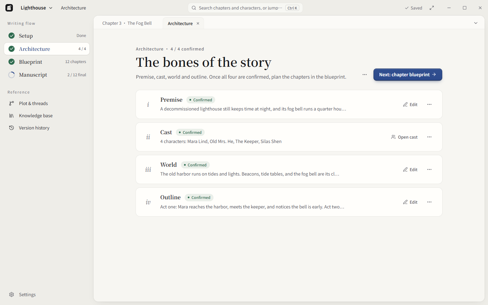

キャストは構成と並行して編集します。各キャラクターにはプロフィール、現在の状態、関係図があります。キャラクターカードを貼り付けたり、ファイルからインポートしたりできます。

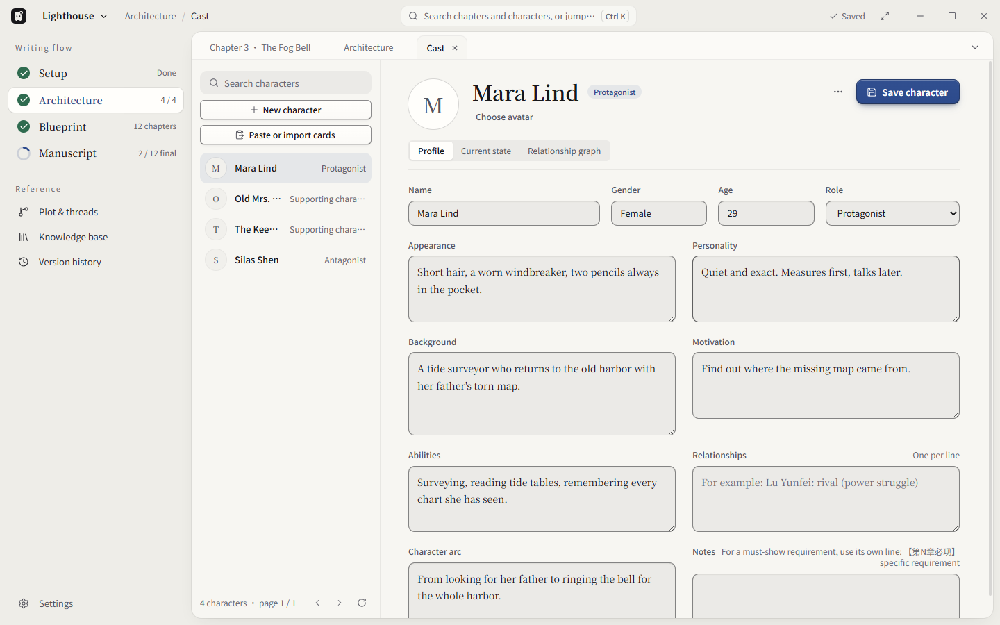

### 人物のタイムライン：第 N 章では第 N 章時点の人物で書く

キャストページでは、キャラクターの現在の状態の上に「Timeline · N changes」が表示されます。展開すると、章ごとの状態と関係の変化とその出どころが一覧表示されます。確定稿から記録された変化は、引用された本文を読めます。状態を手で編集するときは、何章から有効にするかを選べます。

- 第 N 章を書く、または書き直すとき、プロンプトの人物の状態と関係は最新の値ではなく、第 N 章時点のタイムラインから取られます。前の章を後から補って書いても、人物が後の出来事を先に知ってしまうことはありません。
- 確定時に人物の関係の変化も同じリクエストで記録し、追加のリクエストは発生しません。あなたの設定と食い違う場合は、保留中の提案として表示され、Adopt、Keep my setting、Decide later から選べます。
- ブループリント生成時にモデルが提案した新しいキャラクターと関係も、保留中の提案になります。1 人ずつ新規作成するか、既存のキャラクターに対応付けるか、採用しないかを選びます。

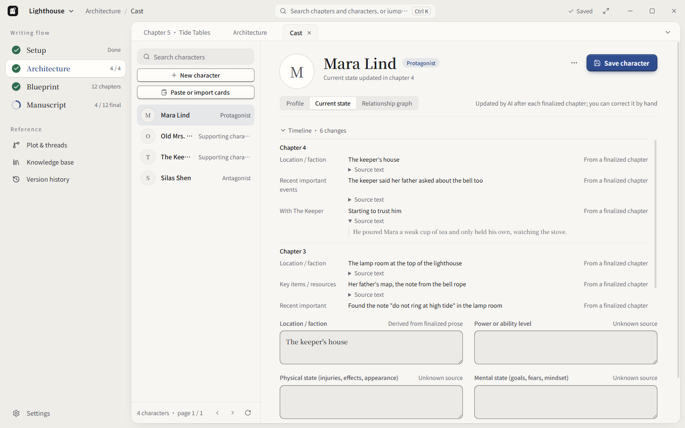

### 章ブループリント：書く前に各章を計画する

ブループリントページでは、本を 1 章ずつ計画します。各章には、主人公の目標、葛藤と転換、サスペンスのフック、登場するキャラクターを記述します。AI は章の範囲ごとにブループリントを生成でき、中断された実行は続きから再開できます。

メインボタンは「Write chapter N」です。その横の小さなポップオーバーには、今回の実行のオプション（使用するモデルと、任意の一行の作者ガイダンス）だけが入っています。複数の章を続けて書くには「Batch write」を使います。一度に最大 10 章まで書けます。

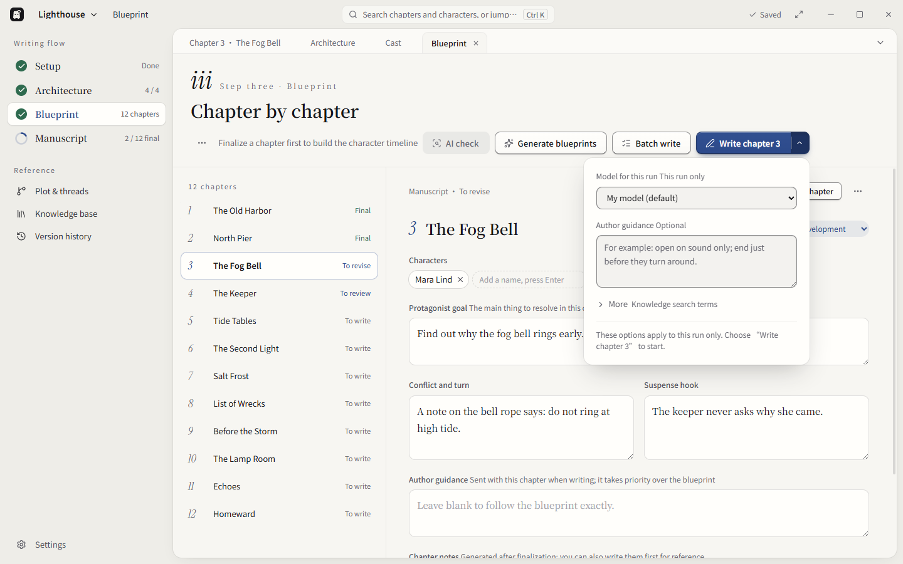

ブループリントには 2 種類のチェックがあり、どちらも執筆を止めません。

- **保存時の通知**：AI が生成したブループリントで 2 人の関係がタイムラインと逆になっている場合や、死亡したキャラクターが登場する場合、ブループリントページに根拠付きの通知が出ます。「This is intentional」で、その章だけ、または本全体を対象外にできます。
- **AI check**：1 回押すごとにモデルへ 1 回リクエストを送り、未確定の章のブループリントを人物のタイムラインと照合して、結果を章ごとに一覧表示します。人物のタイムラインと、保存済みのブループリントが必要です。本が長く、未確定のブループリントが 1 回のリクエストに収まらない場合は前のほうの章だけがチェックされ、結果に最後の章が表示されます（「Checked through chapter N」または「AI check reached chapter N」）。

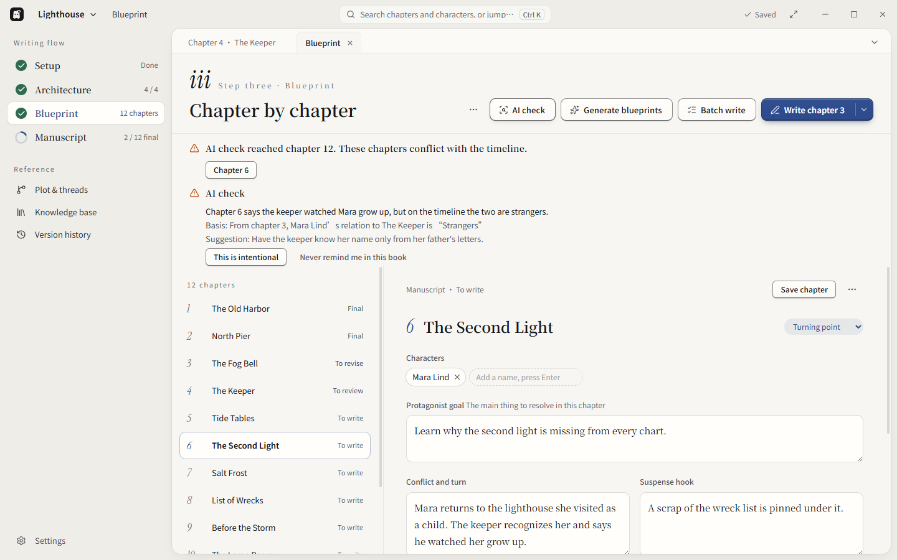

### 伏線：期限の章でリマインド

「Plot & threads」ページでは、メインプロット、サブプロット、伏線がどの章で張られ、進展し、回収されたかを章ごとに記録します。

- 章を書くとき、Pagekin は期限が来た伏線、期限切れの伏線、その章に割り当てた伏線から、その章で進める、または回収するタスクを選びます。プロンプトには期限切れかどうかが明記され、レビューで確認されます。
- 執筆ポップオーバーに「N threads to handle here」の行があり、伏線を 1 章または 3 章先送りでき、取り消しもできます。まだ期限前の伏線を、この章で進めることもできます。
- レビューがある章で伏線が回収されたと判断した場合、確定後に「Confirm resolved」で記録します。回収予定の章が全体の計画章数を超える伏線には印が付きます。

### 原稿：下書き、レビュー、推敲、確定

単一章ビューでは、1 つの章を未執筆から確定稿まで仕上げます。AI が下書きを書いた後、自分で編集することも、AI にレビューを依頼することもできます。レビューレポートには各指摘が一覧表示されます。それぞれにチェックを入れるか無視するかを選び、自分の指摘を追加することもできます。推敲結果は差分として返され、段落ごとに確認するため、何も上書きされません。納得できたら、その章を確定します。

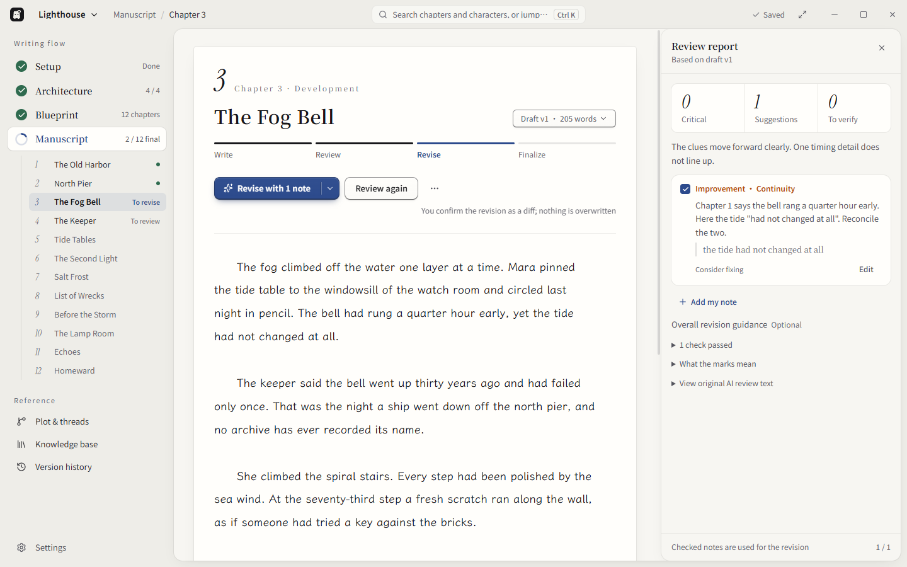

執筆中、AI が受け取るのは、その章のブループリント、関連するキャラクター、世界観、それまでの章の要約、直前の章の全文、その章で扱う伏線であり、本全体のチャット履歴ではありません。

- **注釈の一括修正**：本文を選択して「Add annotation」を選びます。複数の箇所に注釈を付けたら「Revise all (N)」でまとめてモデルに送ります。削除部分は赤、追加部分は緑で表示され、1 か所ずつ編集、再生成、採用ができ、「Accept all」でまとめて採用することもできます。章ページで注釈の履歴を確認できます。
- **キーボードで書く**：Tab キーで段落の字下げとして全角スペースが 2 つ挿入され、章全体をキーボードだけで書けます。Ctrl/⌘+F で章内を検索できます。

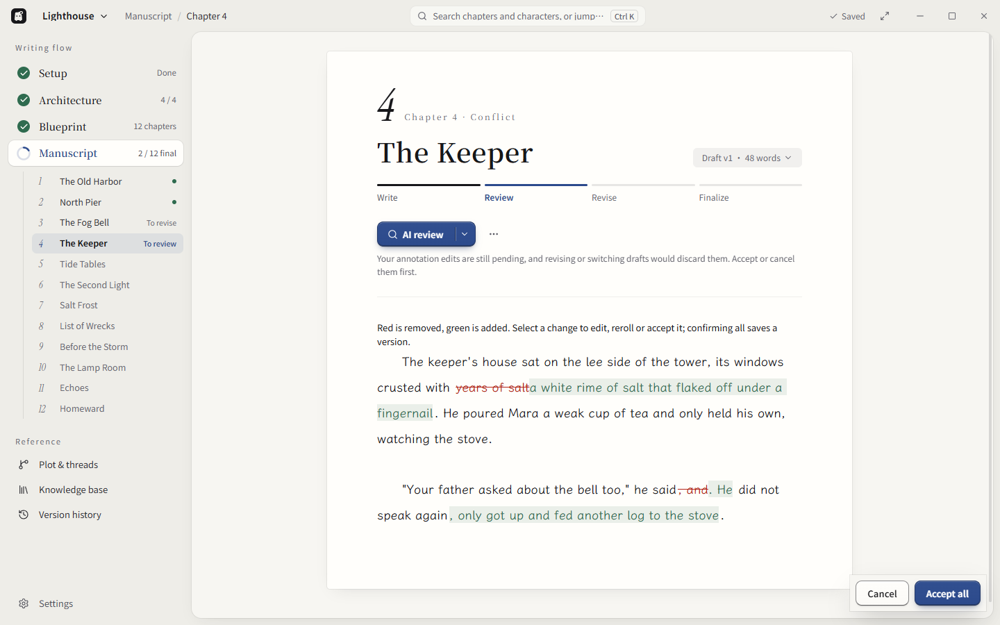

### 確定後の処理、再編集、ゴミ箱

章を確定すると、Pagekin は確定稿をナレッジベースに取り込み、章の要点を生成し、人物の状態と関係を更新します。後処理が失敗またはキャンセルされても確定稿は保存済みで、終わっていないステップを再試行できます。

- **Reopen to edit**：確定済みの章で選ぶと、現在の確定稿が再編集用の下書きとしてコピーされ、通常どおり編集、レビュー、推敲ができます。確定ダイアログは、置き換えが後続の章、人物の状態、伏線の確認に与える影響を先に一覧表示します。元の確定稿は「Replaced final」として読み取り専用でバージョン履歴に残ります。
- **Check later blueprints**：置き換えの後、AI が未確定の後続の章について修正案を、根拠と変更前後の比較付きで出します。1 件ずつ Accept か Don't use を選びます。変更するのはブループリントだけで、本文は変えません。
- **ゴミ箱（Trash）**：確定済みの章で「Delete manuscript…」を選ぶと、本文とそのすべてのバージョンはゴミ箱に入り、Restore または Delete permanently を選べます。ブループリントの「Delete chapter…」と下書きの「Delete this draft…」はゴミ箱に入らず、元に戻せません。途中の章を削除した場合は、「Rewrite chapter N」で同じ位置に書き直せます。

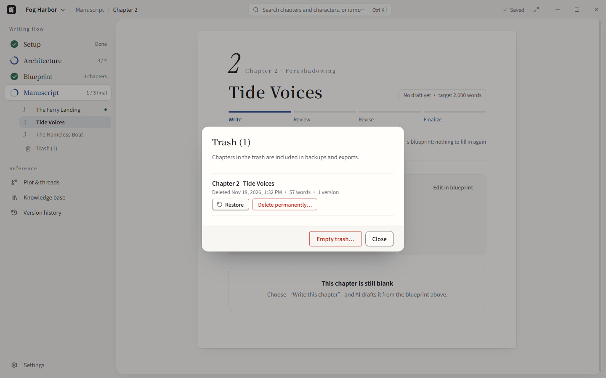

### ナレッジベースと検索：執筆時に資料を自動で参照

- 参考資料（.txt、.md）をインポートできます。確定稿は確定後の処理でナレッジベースに入ります。
- 埋め込みモデルがあるとセマンティック検索になります。埋め込みモデルは「Settings → Retrieval model」で設定したモデルです。設定していない場合でも、既定のモデルが埋め込みに対応していれば（用途の記録がない旧い設定を含む）、Pagekin は既定のモデルを使います。どちらもない場合はローカルの全文検索を使い、中国語の検索語は単語に分割されるため、一部の語だけを含む段落も見つかります。
- 「Settings → Retrieval model」で、リランキングモデルを任意で追加できます。検索はまず多めに段落を集め、リランキングしてから最も関連性の高いものを残します。リランキングが失敗した場合は元の順序で表示されます。
- 途中の章を補って書くとき、検索はその章とそれ以降の章の確定稿を返さないため、後の展開を先取りすることはありません。

### 実行シート：AI が何をしているかを確認する

すべての生成実行は実行シートに表示され、In progress、History、Diagnostics のタブがあります。出力が書かれていく様子を見ながら、いつでもキャンセルできます。バッチは一時停止できます。あるステップが 15 秒間進まないと、カードに待ち時間が表示されます。

実行が失敗した場合、それまでに書かれたテキストは復旧カードとして保持され、採用、コピー、または破棄を選べます。Pagekin がバックグラウンドにあるとき、執筆、レビュー、推敲、確定、一括執筆が終わるとシステム通知が出ます。「Settings → Appearance」の「Notify me in the background」でオフにできます。

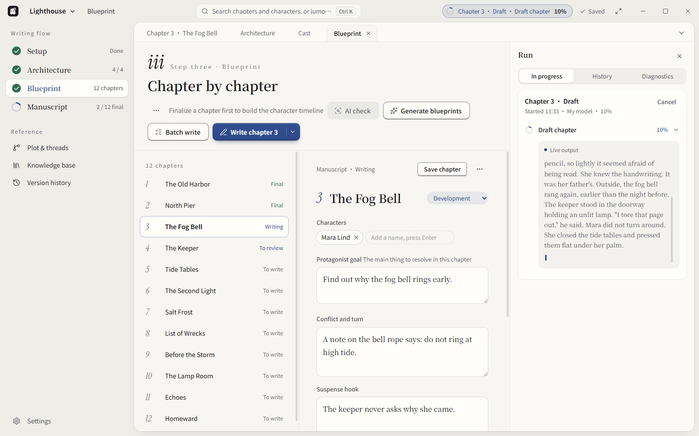

### バージョン、エクスポート、バックアップ

- **バージョン履歴**：章の過去のバージョンはすべて保持されます。現在の下書きと比較したり、新しい下書きとして復元したりできます。
- **エクスポート**：結合した Markdown、章ごとの Markdown ファイル、またはプレーンテキスト。
- **バックアップ**：本をコンピューター上にアーカイブしたり、接続した WebDAV クラウドにバックアップしたりできます。復元すると、必ず新しいコピーが作成されます。

### 執筆スキル：自分の執筆ルールを持ち込む

「Writing skills」設定ページで、ローカルのスキルフォルダーか単一の SKILL.md を選ぶか、GitHub 上のスキルのアドレスを入力すると、プロンプトのみの執筆スキル（典型的な AI っぽい文体を取り除くもの、特定の文体やジャンル向けのものなど）をインポートできます。SKILL.md が参照する参考テキストファイルも含まれます。アプリはスキルを読み込み、インストール前にその内容を表示します。企画、下書き、レビュー、推敲のいずれかのステージに紐付けると、そのステージのすべての生成にスキルが含まれます。

サポートしているのは、自己完結した SKILL.md プロンプトのみです。スクリプト、フック、サブエージェント、ツール要件はインストールされないため、スキルがあなたのコンピューター上でコードを実行することはできません。

### ダークテーマと 3 つのインターフェース言語

外観はライトとダークから選べます。インターフェースは中国語、英語、日本語で利用できます。日本語インターフェースは第 1 段階で、インターフェースの枠組みとエラーメッセージが日本語になり、その他の文言は英語のままです。「Settings → Appearance → Interface language」で「日本語」を選びます。システムの言語が日本語の場合、初回起動時は日本語インターフェースになります。本の執筆言語は中国語または英語で、日本語インターフェースで作成した本の執筆言語は既定で英語です。

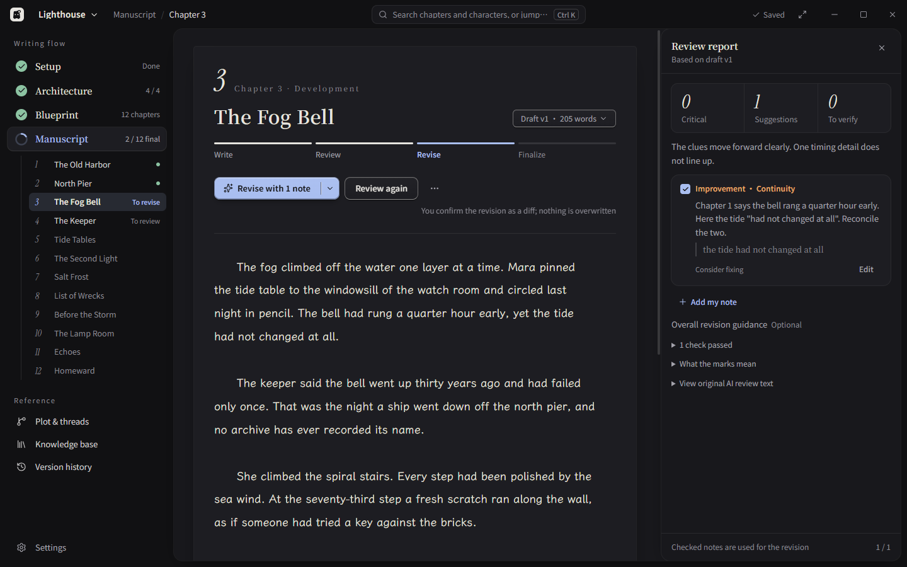

## AI チャットで小説を書くのとの違い

チャット画面で長編を書くと、前後の矛盾、伏線の書き忘れ、前の章を直したら後の章が崩れる、といった問題がよく起きます。Pagekin はこれを、伸び続ける会話ではなく本のデータで管理します。

- **コンテキストは章ごとに組み立てる**：各章には、その章に必要なブループリント、キャラクター、世界観、それまでの要約、直前の章、その章で扱う伏線を渡します。本全体を 1 つの会話に収める必要はありません。
- **人物の状態は章に合わせる**：第 N 章では第 N 章時点の状態と関係を使うため、前の章を補って書いても後の出来事が漏れません。
- **伏線に期限がある**：その章で扱う伏線がプロンプトに入り、レビューが確認し、回収はあなたが確定します。
- **修正には影響一覧が付く**：確定稿を置き換える前に影響範囲を表示し、その後 AI に後続のブループリントだけを直させることができます。
- **AI があなたの文章を直接上書きしない**：推敲、注釈の修正、推定された設定、関係の変化は、差分か提案として表示され、あなたが採用します。
- **作品はローカル、モデルは自分で選ぶ**：データはローカルの SQLite データベースと本のフォルダーにあります。モデルはクラウドの API でも、ローカルモデルでもかまいません。

## 対応モデルとサービス

Pagekin はモデルの提供や利用枠のホスティングを行いません。設定で、ご自身のサービスアドレス、モデル名、API キーを入力してください。3 つのリクエストプロトコルに対応しています：

- **OpenAI 互換**：Chat Completions API と互換性のある任意のサービス。
- **ネイティブ Gemini**：Google Gemini。
- **Anthropic**：Messages API と互換性のあるサービス（Zhipu の Anthropic エンドポイントなど）。

設定には、以下のプロバイダーのプリセットが含まれています：

| プロバイダー | プロトコル | 備考 |
| --- | --- | --- |
| DeepSeek | OpenAI 互換 | プリセットアドレス `https://api.deepseek.com` |
| SiliconFlow | OpenAI 互換 | プリセットアドレス `https://api.siliconflow.cn/v1` |
| BigModel (Zhipu) | OpenAI 互換 | プリセットアドレス `https://open.bigmodel.cn/api/paas/v4` |
| BigModel (Zhipu Anthropic) | Anthropic | プリセットアドレス `https://open.bigmodel.cn/api/anthropic` |
| OpenAI | OpenAI 互換 | プリセットアドレス `https://api.openai.com` |
| xAI (Grok) | OpenAI 互換 | プリセットアドレス `https://api.x.ai/v1` |
| Google Gemini | ネイティブ Gemini | プリセットアドレス `https://generativelanguage.googleapis.com` |
| Ollama (local) | OpenAI 互換 | モデルはあなた自身のコンピューター上で動作します |
| NovelAI | OpenAI 互換 | 最小限の互換性のみで、実アカウントでの完全な検証はしていません |
| Custom | 3 つのいずれか | 任意の互換サービスアドレス |

「Custom」で変更できるのは、上記 3 つのプロトコルの範囲内でのアドレス、モデル名、認証情報のみです。任意の HTTP インターフェースではありません。Azure、ネイティブの KoboldAI などのインターフェースには専用のアダプターが必要で、URL を差し替えるだけでは動作しません。

- **モデル一覧**：アドレスと API キーを入力すると、エンドポイントのモデル一覧を自動で取得します。任意のモデル名や、ローカルのモデルファイルのパス（llama.cpp など）も入力できます。
- **コンテキストウィンドウ**：モデルを選ぶと、コンテキストウィンドウが出どころ（プロバイダー、内蔵データ、既定値、手入力、実測）付きで自動入力されます。1 章を書くときにプロバイダーが長すぎるとして拒否し、エラーから実際のウィンドウを読み取れた場合、Pagekin はそのウィンドウを記録し、参考資料を減らして 1 回だけ書き直します。
- **ステージ別モデル**：「Settings → Advanced → Models by stage」で、企画、下書き、レビュー、推敲、確定後の処理にそれぞれモデルを割り当てられます。割り当てのないステージは既定のモデルを使います。
- **検索用モデル**：ナレッジベースのセマンティック検索には、埋め込みに対応したモデルが必要です。設定の「Retrieval model」で個別に設定でき、未設定の場合は埋め込みに対応した既定のモデルが代わりに使われます。リランキングモデルは任意です。

### Ollama でローカルモデルを実行する

```text
Provider:  Ollama (local) or Custom
Protocol:  OpenAI-compatible
Base URL:  http://127.0.0.1:11434/v1
API key:   may be left blank; if the UI requires one, use any placeholder
Model:     your Ollama model name, for example qwen3:14b
```

埋め込みモデルも `/v1` のアドレスを使います。Ollama のネイティブインターフェースである `http://127.0.0.1:11434/api` は使わないでください。

## ダウンロードとインストール

公式インストーラーは [GitHub Releases](https://github.com/EthanYoQ/Pagekin/releases/latest) からのみダウンロードしてください。

動作環境：Windows x64、または macOS（Apple Silicon 版と Intel 版のインストーラーがあります）。このほかに、クラウドの API キーか、Ollama などのローカル推論サービスが必要です。

### Windows x64

```text
ai-novel-writer-setup-<version>.exe
```

1. インストーラーを実行します。アップグレードで更新されるのはアプリケーションのみで、本、キャラクターカード、設定は削除されません。それでも、大切な作品は事前にバックアップしてください。
2. インストール後、「Settings → About & updates」でアップデートを確認できます。新しいバージョンはまず通知されます。「Download update」を選んだ場合にのみダウンロードされ、完了したら今すぐ再起動するか後で再起動するかを選びます。
3. 旧来のポータブル ZIP ビルドは、アップデーターを自動的に取得できません。一度だけ公式インストーラーを手動でインストールしてください。

現在、インストーラーにはコード署名がされていません。Windows で発行元不明の警告が表示される場合があります。ダウンロードページがこのリポジトリの公式 GitHub Release であることを確認してから続行してください。

### macOS (Apple Silicon と Intel)

```text
ai-novel-writer-mac-arm64-<version>-installer.dmg
ai-novel-writer-mac-x64-<version>-installer.dmg
```

1. `arm64` は Apple Silicon 搭載の Mac（M1、M2、M3、M4 以降）向け、`x64` は Intel 搭載の Mac 向けです。
2. DMG からアプリを Applications にドラッグして起動します。アプリは新しいバージョンを通知しますが、macOS では自身をダウンロードしたり置き換えたりしません。アップデートすると公式の Release ページが開き、お使いのアーキテクチャ向けのインストーラーをダウンロードできます。
3. どちらのインストーラーも ad-hoc 署名のみで、Developer ID 署名はなく、公証もされていません。Gatekeeper にアプリがブロックされた場合は、このリポジトリの公式 GitHub Release から入手したものであることを確認してから、Finder でアプリを Control キーを押しながらクリックして「開く」を選ぶか、「システム設定 → プライバシーとセキュリティ」で許可してください。

## データとプライバシー

| データまたは動作 | 保存場所または送信先 |
| --- | --- |
| 本、キャラクター、ブループリント、下書き、確定稿 | あなたの本のフォルダーと、ローカルの SQLite データベース。 |
| 「Delete manuscript…」で削除した確定済みの章 | 現在の本のゴミ箱。完全に削除するまでは復元できます。 |
| 失敗した実行からの復旧カード | 現在の本のローカルデータベースのみ。勝手に下書きや確定稿になることはありません。 |
| インポートした参考資料 | ローカルの本の中に保存されます。埋め込みモデル（既定のモデルによる代替を含む）がある場合、インポート時に資料の段落がそのモデルに送信されます。 |
| ローカルモデルへのリクエスト | 設定したローカルまたは LAN 上の推論サービスに送信されます。 |
| クラウドモデルへのリクエスト | プロンプトとコンテキストは、選択したプロバイダーに送信されます。 |
| ナレッジベースの取り込みと検索 | 埋め込みモデル（既定のモデルによる代替を含む）がある場合は、取り込んだ資料と確定稿の段落、および検索語がそのモデルに、リランキングモデルを設定した場合は検索語と取得した段落がリランキングモデルに送信されます。どちらもない場合、検索はローカルだけで行われます。 |
| モデル設定と API キー | アプリデータディレクトリの `ai-novel-writer` フォルダー（Windows では `%APPDATA%\ai-novel-writer`、macOS では `~/Library/Application Support/ai-novel-writer`）に保存されます。OS のアカウントを保護し、このフォルダーを共有しないでください。 |
| アプリの環境設定 | モデル設定と同じフォルダーに保存されます。 |

以前のバージョンでは、設定を `~/.vela` に保存していました。現在のバージョンは起動時にそれらを上記のフォルダーへコピーし、元のファイルには手を加えません。

アプリは、モデルアカウント、クラウド生成、プロモーションメッセージを提供しません。アップデートの確認では、公開されている GitHub Releases のみを読み取ります。

## よくある質問

### Pagekin は無料ですか？

はい。GPL-3.0 ライセンスのオープンソースです。クラウドモデルの呼び出しにかかる費用は、あなたとモデルプロバイダーとの間の問題です。Ollama 経由のローカルモデルであれば、プロバイダーは一切不要です。

### AI で小説を書くのに、どのモデルが使えますか？

OpenAI 互換の Chat Completions API で提供されている任意のモデルが使えます（DeepSeek、SiliconFlow 経由の Qwen、Zhipu GLM、OpenAI、xAI Grok など）。Google Gemini はネイティブプロトコル、Zhipu の Anthropic エンドポイントは Anthropic プロトコルを使います。ローカルモデルには Ollama を使います。出力の品質は選択したモデルによって異なります。アプリはモデルの出力について一切保証しません。

### データはどこに保存されますか？アップロードされますか？

あなた自身のコンピューター上の、本のフォルダーとローカルの SQLite データベースです。執筆、レビュー、小説インポート後の分解や後処理など、モデルを使う操作では、関連する本文、設定、コンテキストが設定したモデルサービスに送信されます。埋め込みモデル（既定のモデルによる代替を含む）がある場合、ナレッジベースへの取り込みでは資料の段落が、検索では検索語がそのモデルに送信されます。リランキングモデルを設定した場合は、検索語と取得した段落がそのモデルに送信されます。非公開の資料をローカルに留めたい場合は、インポートの前に、使うモデルをすべてローカルのモデルに切り替えてください。既定のモデル、「Models by stage」で割り当てたモデル、Retrieval model、リランキングモデルが対象です。Retrieval model が未設定の場合は既定のモデルが代わりに使われます。WebDAV バックアップは、WebDAV を接続してバックアップを開始したときにのみアップロードします。

### オフラインで小説を書けますか？

はい。ただし、使うモデルがすべてコンピューター上か LAN 上にある必要があります。既定のモデル、「Models by stage」で割り当てたモデル、Retrieval model、リランキングモデルが対象です。アップデートの確認、GitHub からのスキルのインポート、WebDAV バックアップ、クラウドモデルにはネットワーク接続が必要です。

### 小説はどのくらいの長さにできますか？前後の矛盾は防げますか？

総章数は自分で設定でき、固定の上限はありません。各章について、AI はその章のブループリント、関連するキャラクター、世界観、それまでの章の要約、直前の章の全文、その章で扱う伏線を受け取るため、本全体を 1 つの会話に収める必要はありません。人物の状態は章に合わせて取られ、ブループリントの AI check で人物のタイムラインとの矛盾を確認できます。Batch write は 1 回の実行で最大 10 章を処理し、実行を重ねて書き続けることができます。

### 確定した章を後から直せますか？章を誤って削除したら？

直せます。確定済みの章で「Reopen to edit」を選び、再確定すると元の確定稿を置き換えます。元の確定稿はバージョン履歴に残ります。「Delete manuscript…」で削除した確定済みの章はゴミ箱に入り、復元できます。

### 書きかけの小説をインポートして続きを書けますか？

書けます。ライブラリの「Novel breakdown & imitation」で .txt、.md、.epub をインポートし、「My manuscript」を選びます。書いた章は確定稿として取り込まれ、設定、構成、キャラクター、ブループリントを推定してから、次の章を書き続けられます。

### 日本語で小説を書けますか？

現時点では書けません。本の執筆言語は中国語または英語です。日本語に対応しているのはインターフェースで、現在は第 1 段階です。

### 1.5.0 にアップグレードするにはどうすればよいですか？

1.1.0、1.2.x、1.3.x、1.4.x のいずれかをインストールしている場合は、アプリ内で更新の通知が届きます（macOS では新しいインストーラーを手動でダウンロードします）。1.5.0 でプロジェクトを開くと、プロジェクトのデータがアップグレードされます。その後は 1.4.x 以前のバージョンではそのプロジェクトを開けず、1.5.0 でエクスポートしたアーカイブも復元できません。大切な本は事前にバックアップしてください。さらに古いバージョンのプロジェクトは、ライブラリで「Import」を選び、次に「Import an old project copy」を選びます。インポートすると新しいコピーが作成され、元のプロジェクトには手が加えられません。

### AI っぽい文体を取り除くスキルなどをインポートできますか？

はい。「Writing skills」設定ページで、ローカルのスキルフォルダーか SKILL.md を選ぶか、スキルの GitHub アドレスを入力し、内容を確認してからインストールし、下書きや推敲などのステージに紐付けます。サポートしているのはプロンプトのみの SKILL.md ファイルで、スクリプトがインストールされたり実行されたりすることはありません。

### アシスタントチャットはどこに行きましたか？

1.3.0 以降のインターフェースでは、アシスタントチャットの入口を当面非表示にしています。別途復活する予定です。下書き、レビュー、推敲などのワークフローには影響ありません。

### Windows や macOS でインストーラーが安全ではないと表示されます。どうすればよいですか？

Windows のインストーラーは署名されておらず、Mac のインストーラーは ad-hoc 署名のみで Apple による公証も受けていないため、システムが警告を表示します。インストーラーがこのリポジトリの公式 GitHub Release から入手したものであることを確認したうえで、「ダウンロードとインストール」の手順に従って許可してください。

## 現在の制限

- URL とキーだけでは、サードパーティの API が動作することは保証されません。サポートしているのは、実装済みの 3 つのプロトコルとプリセットのみです。
- 執筆言語は中国語と英語のみです。日本語インターフェースで翻訳されているのは、インターフェースの枠組みとエラーメッセージだけです。
- アプリは、あなたの創作上の判断、事実確認、著作権に関する判断の代わりにはなりません。AI が書いたものはすべて確認してください。
- オンライン出版、読者コミュニティ、クラウドモデルアカウントは提供していません。

## ソースからビルドする

Node.js 22.14 以降と、リポジトリで固定されている pnpm のバージョンが必要です。

```sh
git clone https://github.com/EthanYoQ/Pagekin.git
cd Pagekin
pnpm install --frozen-lockfile
pnpm dev
```

公式インストーラーは GitHub Actions でビルドされます。Windows x64、macOS Apple Silicon、macOS Intel の各インストーラーは、それぞれの検証に合格したうえで 1 つの GitHub Release に掲載されます。ドキュメントの権威、ADR、開発ルールについては [`docs/README.md`](docs/README.md) をご覧ください。ロゴ、カラー、デザインファイルは[ブランドキット](docs/brand/README.md)（中国語）にまとめられています。

## コントリビューション

バグの報告や機能のリクエストは [GitHub Issues](https://github.com/EthanYoQ/Pagekin/issues) で、使い方に関する質問は [Discussions](https://github.com/EthanYoQ/Pagekin/discussions) でお願いします。プルリクエストを作成する前に [CONTRIBUTING.md](CONTRIBUTING.md) をお読みください。これは公開リポジトリのため、提出するものから API キー、小説の全文、ローカルのパスを取り除いてください。

## DeepSeek Harness プラグイン（凍結）

このリポジトリには、DeepSeek Harness 向けの Web プラグインである `@ethanyoq/dsh-ai-novel-writer` `0.1.0` の開発者プレビューも含まれています。このプラグインは凍結されており、短期的な機能開発の予定はありません。デスクトップアプリケーションの機能の 10% 未満しか備えておらず、デスクトップのプロジェクトを読み込まず、デスクトップアプリの代わりにもなりません。[npm](https://www.npmjs.com/package/@ethanyoq/dsh-ai-novel-writer) で MIT ライセンスのもと別途公開されています。インストールと使い方については[プラグインの README](plugins/dsh-ai-novel-writer/README.md) をご覧ください。

## ライセンス

デスクトップアプリケーションは [GPL-3.0](LICENSE) ライセンスのもとでオープンソースとして公開されています。
