<div align="center">

[English](README_en.md) | [中文](README.md) | [日本語](README_ja.md) | **Türkçe**

</div>

<p align="center">
  
</p>

<h1 align="center">Pagekin</h1>

<p align="center"><sub>Eski adıyla “AI Novel Writer” (AI 小说作家). Çince adı: 书童, “bilginin çırağı”.</sub></p>

<p align="center">
  <strong>Pagekin, yapay zeka ile uzun bir roman yazmak isteyen yazarlar için Windows ve macOS'a yönelik ücretsiz, açık kaynaklı bir yapay zeka roman yazma uygulamasıdır.</strong><br />
  Kurulumdan, hikaye mimarisinden, karakterlerden ve bölüm taslaklarından başlayarak yazım, inceleme, düzeltme ve son bölümlere kadar her seferinde bir bölüm ilerleyin. Ayrıca tarzını taklit etmek için bir referans romanı çözümleyebilir, kendi taslağınızı içe aktararak devam edebilir veya kendi notlarınıza göre yeniden yazabilirsiniz.<br />
  Önce yerel: kitaplarınız kendi bilgisayarınızda kalır. Dahili model yoktur: kendi API anahtarınızı (DeepSeek, OpenAI, Gemini, Zhipu ve diğerleri) kullanın veya Ollama ile yerel bir model çalıştırın.
</p>

Pagekin, EthanYoQ tarafından sürdürülmektedir ve GPL-3.0 altında açık kaynaklıdır. [Resmi web sitesi](https://www.orz.md/en/ai-novel-writer/) ürün genel bakışını, kurulum kılavuzunu ve resmi indirme bağlantılarını sunar.

<p align="center">
  <a href="https://github.com/EthanYoQ/Pagekin/releases/latest"></a><br />
  <a href="https://www.orz.md/en/ai-novel-writer/#demo">Gerçek ekran görüntüleriyle İngilizce ilk kullanım kılavuzu</a><br />
  <sub>Manuel proje kurulumu. Kendi yerel veya bulut modelinizi getirin.</sub>
</p>

<p align="center">
  <a href="https://github.com/EthanYoQ/Pagekin/releases"></a>
  <a href="https://github.com/EthanYoQ/Pagekin/blob/master/LICENSE"></a>
  <a href="https://github.com/EthanYoQ/Pagekin/stargazers"></a>
</p>

<p align="center">
  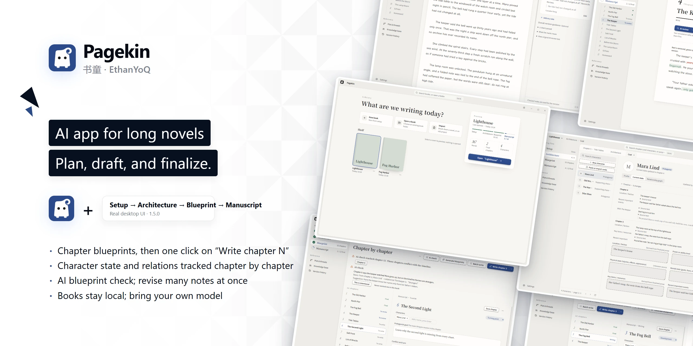
</p>

> ## 1.5.0 sürümündeki yenilikler
>
> - **Çöp Kutusu**: Tamamlanmış bir bölümde "Delete manuscript…" seçtiğinizde, metni ve tüm sürümleri çöp kutusuna gider ve bunları geri yükleyebilirsiniz. Ortadan bir bölüm sildikten sonra kitabın geri kalanı yazılabilir kalır.
> - **Düzenlemek için yeniden aç**: Tamamlanmış bir bölümü yeniden açın. Tekrar tamamlamadan önce Pagekin değişikliğin sonraki bölümleri nasıl etkilediğini listeler ve ardından yapay zeka sonraki taslakları kontrol edebilir.
> - **Karakter zaman çizelgesi**: Her karakter bölüm bölüm durum ve ilişki değişikliklerini kaydeder. N. bölümü yazdığınızda yapay zeka karakterleri N. bölümdeki halleriyle alır.
> - **Hikaye örgüsü hatırlatıcıları**: Örgülerin (thread) teslim bölümleri vardır. Onlara ulaştığınızda, ele alınacak örgüler yazım isteminde bu bölümün görevleri haline gelir ve inceleme bunları kontrol eder.
> - **Taslak yapay zeka kontrolü**: Tamamlanmamış taslakları tersine dönmüş ilişkiler veya ölmüş karakterler açısından karakter zaman çizelgesine göre kontrol eder.
> - **Tüm açıklamaları düzelt**: Bir bölümdeki birçok pasaja açıklama ekleyin, bunları modele birlikte gönderin ve her değişikliği kabul edin.
> - **Japonca arayüz (1. aşama)**, Anthropic protokolü, bilgi tabanı için isteğe bağlı bir yeniden sıralama (reranking) modeli ve arka planda iş bittiğinde bildirimler.
>
> Ayrıntılar için [1.5.0 sürüm notlarına](https://github.com/EthanYoQ/Pagekin/releases/tag/v1.5.0) bakın.

## Ne yapar

Pagekin bir romanın yazılma sırasıyla çalışır: yazar sizsiniz, o sizin sayfanızdır. Her adım kitapta kaydedilir ve bir sonrakini besler. Yapay zeka taslağı yazar ve her adımı siz onaylarsınız.

### Kütüphane: tüm kitaplarınız tek yerde

Kütüphane yazdığınız her kitabı listeler. Önizlemek için bir kapak seçin: geçerli adım, kelime sayısı, son bölümler ve karakterler. Yeni bir kitap başlatabilir veya eski bir sürümden bir projenin kopyasını içe aktarabilirsiniz.

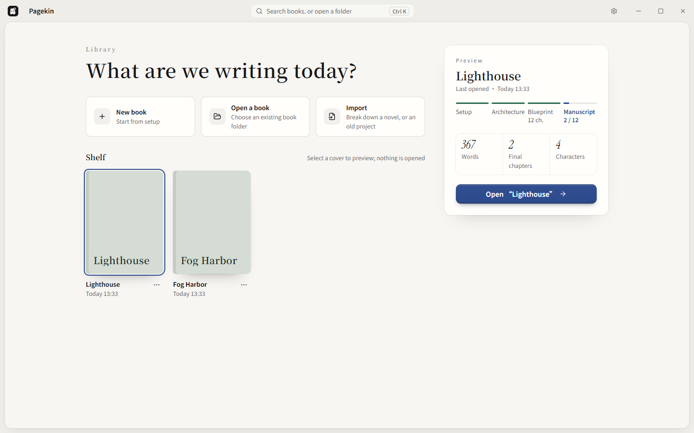

### Çözümleme, taklit, devam ettirme ve yeniden yazma

Kütüphanedeki "Novel breakdown & imitation" bir romanı .txt, .md veya .epub dosyası olarak içe aktarır, bölümlere ayırır ve metnin ne için olduğunu sorar.

- **Çözümleme ve taklit**: "Reference novel" seçin. Yapay zeka yapısını çözümler, tarzını çıkarır, bölüm taslaklarını tahmin eder ve sonraki yazımınız için taklit kısıtlamaları üretir. Bir referans roman yalnızca bilgi tabanına ve çözümlemeye gider. Asla sizin metninize karışmaz.
- **Taslağınıza devam edin**: "My manuscript" seçin. Halihazırda yazdığınız bölümler bölüm numarasına göre tamamlanmış metin olarak içe aktarılır ve yapay zeka sonraki bölümleri o karakterlerden ve olaylardan devam ettirir. Ayrıca "Also infer settings, architecture, characters, and blueprints" seçeneğini işaretleyebilirsiniz. Taslaklar yalnızca taslağı olmayan bölümler için tahmin edilir. Diğer çıkarımlar yalnızca boş alanları doldurur ve içeriğinizden farklı olan sonuçlar tek tek benimseyeceğiniz öneriler olarak görünür. Bir içe aktarma durursa, "Continue import" işlenmiş grupları tekrarlamadan tamamlar.
- **Bir pasaja devam edin**: Düzyazı düzenleyicisinde metin seçin ve araç çubuğunda Continue'yu seçin. Yapay zeka o pasajdan yazmaya devam eder.
- **Yeniden yazma**: Tüm bir bölümü yeniden yazmak için Revise kullanın. İstediğiniz yönü yazın, isteğe bağlı olarak inceleme notlarını kontrol edin ve hangi sürümü tutacağınızı seçmek için sonucu orijinaliyle paragraf paragraf karşılaştırın. Kısa bir pasaj için onu seçin ve kendi talimatınızla Refine, Expand, To dialogue veya "Revise with note" kullanın.

### Kurulum ve mimari: önce hikayeyi kurun

Kurulum sayfası türü, hedef kitleyi, yazım dilini, toplam bölüm sayısını ve bölüm başına kelime sayısını kaydeder. Mimari sayfasında dört bölüm vardır: önerme (premise), oyuncu kadrosu (cast), dünya inşası (worldbuilding) ve olay örgüsü taslağı (plot outline). Yapay zeka her bölümü oluşturabilir veya kendiniz yazabilirsiniz. Dördü de onaylandığında bölüm taslaklarına geçin.

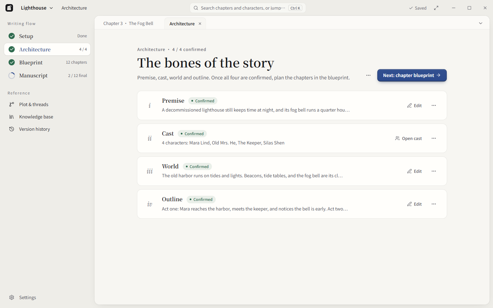

Oyuncu kadrosu mimariyle birlikte düzenlenir. Her karakterin bir profili, geçerli bir durumu ve bir ilişki grafiği vardır. Karakter kartlarını yapıştırabilir veya bir dosyadan içe aktarabilirsiniz.

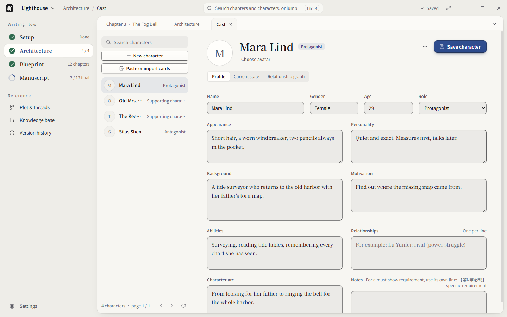

### Karakter zaman çizelgesi: N. bölümdeki halleriyle karakterler

Bir karakterin geçerli durumunun üzerinde, oyuncu kadrosu sayfası "Timeline · N changes" gösterir. Her bölümün durum ve ilişki değişikliklerini kaynaklarıyla birlikte görmek için genişletin. Bir son bölümden kaydedilen değişiklikler için alıntılanan metni okuyabilirsiniz. Bir durumu elle düzenlediğinizde, hangi bölümden itibaren geçerli olacağını seçebilirsiniz.

- N. bölümü yazdığınızda veya yeniden yazdığınızda, istem en son değerleri değil, N. bölümdeki zaman çizelgesinden karakter durumlarını ve ilişkilerini kullanır. Geri dönüp daha önceki bir bölümü doldurursanız, karakterler daha sonra ne olacağını bilmez.
- Tamamlama, ekstra istek olmadan aynı istek içinde ilişki değişikliklerini kaydeder. Bir değişiklik ayarınızdan farklı olduğunda, bekleyen bir öneri Adopt, Keep my setting ve Decide later seçeneklerini sunar.
- Modelin taslakları oluştururken önerdiği yeni karakterler ve ilişkiler de bekleyen öneriler haline gelir. Her birini oluşturur, mevcut bir karakterle eşleştirir veya atlarsınız.

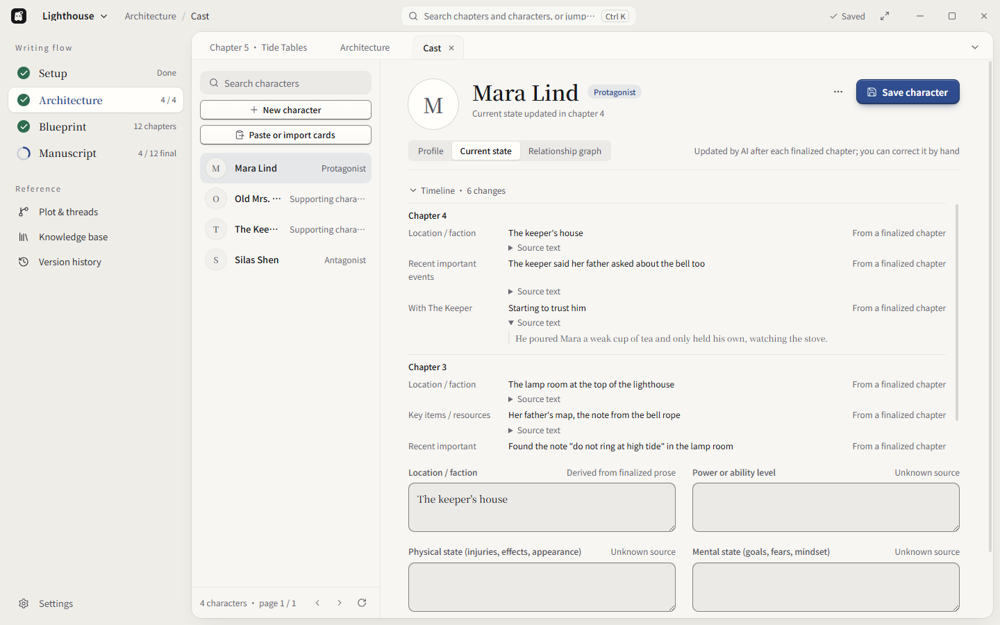

### Bölüm taslakları: yazmadan önce her bölümü planlayın

Taslak sayfası kitabı bölüm bölüm planlar. Her bölüm başkahramanın hedefini, çatışmayı ve dönüm noktasını, gerilim kancasını ve görünen karakterleri belirtir. Yapay zeka bölüm aralıklarında taslaklar oluşturabilir ve kesintiye uğrayan bir çalıştırma devam edebilir.

Ana düğme "Write chapter N"dir. Yanındaki küçük açılır pencere yalnızca bu çalıştırma için seçenekleri tutar: hangi modelin kullanılacağı ve isteğe bağlı bir satır yazar yönlendirmesi. Arka arkaya birkaç bölüm yazmak için bir seferde en fazla 10 bölüme kadar "Batch write" kullanın.

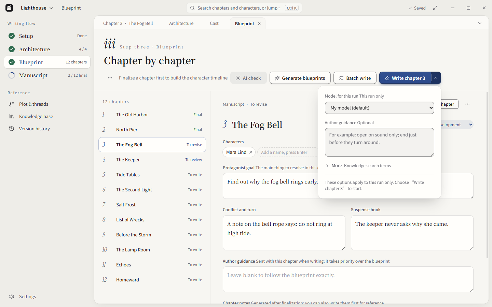

Taslaklar iki kontrol alır. Hiçbiri yazmayı engellemez.

- **Kaydetme sırasında uyarı**: Yapay zeka tarafından oluşturulan bir taslakta ilişkisi zaman çizelgesiyle çelişen iki karakter varsa veya ölmüş bir karakter içeriyorsa, Taslak sayfası dayanağıyla birlikte bir uyarı gösterir. Tek bir bölümü veya tüm kitabı muaf tutmak için "This is intentional" seçin.
- **Yapay zeka kontrolü**: Her tıklama, tamamlanmamış taslakları karakter zaman çizelgesine göre kontrol eden ve sonuçları bölüme göre listeleyen bir model isteği gönderir. Bir karakter zaman çizelgesi ve kaydedilmiş taslaklar gerektirir. Tamamlanmamış taslakları tek bir isteğe sığmayan uzun bir kitapta yalnızca daha önceki bölümler kontrol edilir ve sonuç sonuncusunu adlandırır ("Checked through chapter N" veya "AI check reached chapter N").

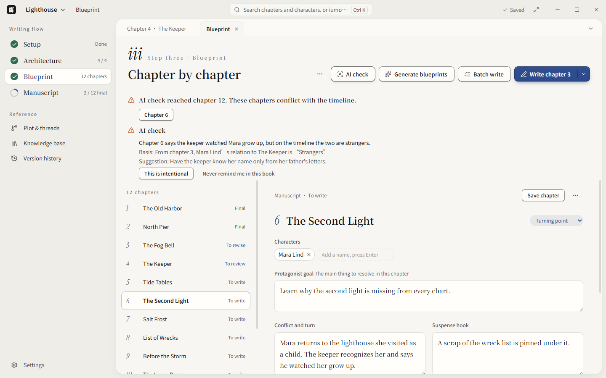

### Hikaye örgüleri: teslim bölümüne göre hatırlatıcılar

Plot & threads sayfası ana olay örgüsünün, alt olay örgülerinin ve öngörülerin (foreshadowing) bölüm bölüm nerede atıldığını, ilerletildiğini veya çözüldüğünü kaydeder.

- Bir bölüm yazdığınızda, Pagekin bu bölümün görevlerini teslim tarihi gelen, gecikmiş ve atanmış örgülerden seçer. İstem her birinin gecikmiş olup olmadığını işaretler ve inceleme bunları kontrol eder.
- Yazma açılır penceresi "N threads to handle here" gösterir. Bir örgüyü 1 veya 3 bölüm ileri taşıyıp geri alabilir ya da henüz teslim tarihi gelmemiş bir örgüyü ilerletebilirsiniz.
- İnceleme bir bölümün bir örgüyü çözdüğünü bulduğunda, kaydetmek için tamamlamadan sonra "Confirm resolved" seçin. Örgü sayfası, karşılık bölümü planlanan bölüm sayısının ötesinde olan örgüleri işaretler.

### Taslak metin: taslak yaz, incele, düzelt, tamamla

Tek bölüm görünümü bir bölümü yazılmamıştan son hale getirir. Yapay zeka bir taslak yazdıktan sonra kendiniz düzenleyebilir veya yapay zekadan incelemesini isteyebilirsiniz. İnceleme raporu her notu listeler. Her birini işaretler veya yok sayarsınız ve kendi notunuzu ekleyebilirsiniz. Düzeltme, paragraf paragraf onayladığınız bir diff olarak geri döner, böylece hiçbir şeyin üzerine yazılmaz. Doğru okunduğunda bölümü tamamlayın.

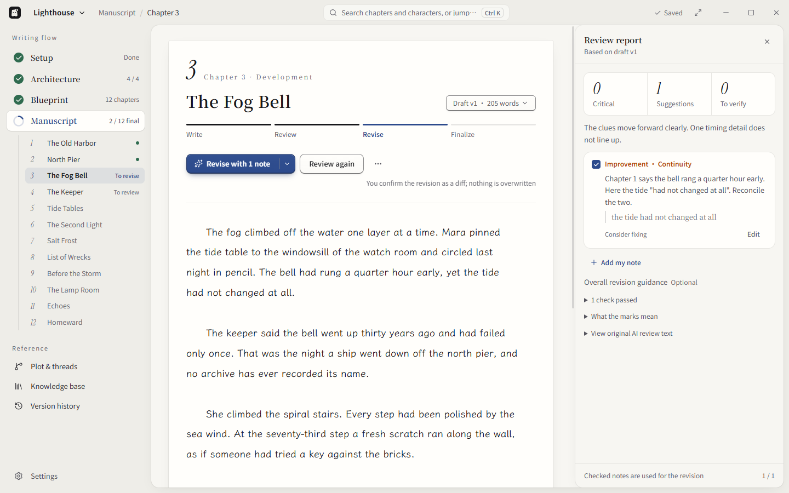

Yazarken yapay zeka bu bölümün taslağını, ilgili karakterleri, dünya inşasını, önceki bölümlerin özetlerini, önceki bölümün tamamını ve bu bölümün ele alması gereken örgüleri alır; tüm kitabın sohbet dökümünü değil.

- **Tüm açıklamaları düzelt**: Metni seçin ve "Add annotation" seçin. Birkaç pasaja açıklama ekledikten sonra, bunları modele birlikte göndermek için "Revise all (N)" seçin. Kaldırılan metin kırmızı, eklenen metin yeşil görünür. Her değişikliği düzenleyebilir, yeniden oluşturabilir veya kabul edebilir ya da "Accept all" seçebilirsiniz. Bölüm sayfası açıklama geçmişini saklar.
- **Klavyeyle yazma**: Tab tuşu paragraf girintisi olarak iki tam genişlikli boşluk ekler ve tüm bir bölüm yalnızca klavyeyle yazılabilir. Ctrl/⌘+F bölümde arama yapar.

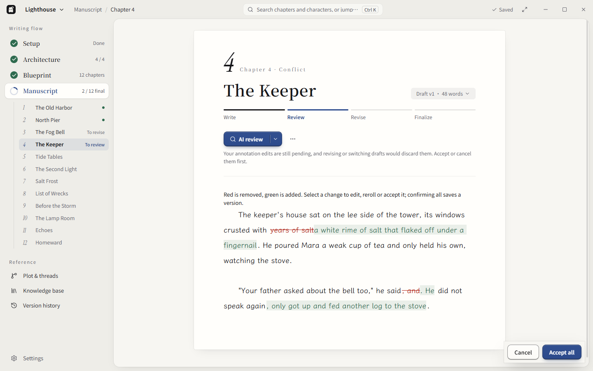

### Son işleme, Düzenlemek için yeniden aç ve Çöp Kutusu

Her bölüm tamamlandıktan sonra, Pagekin son metni bilgi tabanına aktarır, bölüm notları oluşturur ve karakter durumları ile ilişkilerini günceller. Son işleme başarısız olursa veya iptal edilirse, son metin zaten kaydedilmiştir ve tamamlanmamış adımları yeniden deneyebilirsiniz.

- **Düzenlemek için yeniden aç**: Tamamlanmış bir bölümde "Reopen to edit" seçin. Geçerli son metin, her zamanki gibi düzenlediğiniz, incelediğiniz ve düzelttiğiniz yeniden açılmış bir taslağa kopyalanır. Tamamlama iletişim kutusu önce değiştirmenin sonraki bölümleri, karakter durumlarını ve örgü onaylarını nasıl etkilediğini listeler. Eski son metin sürüm geçmişinde salt okunur olarak "Replaced final" şeklinde kalır.
- **Sonraki taslakları kontrol et**: Bir değiştirmeden sonra yapay zeka, dayanağı ve öncesi-sonrası görünümüyle birlikte sonraki tamamlanmamış bölümler için değişiklikler önerir. Her biri için Accept veya Don't use seçersiniz. Yalnızca taslakları değiştirir, asla bölüm metnini değiştirmez.
- **Çöp Kutusu**: Tamamlanmış bir bölümde "Delete manuscript…" seçtiğinizde, metni ve tüm sürümleri çöp kutusuna gider; burada Restore veya Delete permanently yapabilirsiniz. Bir taslaktaki "Delete chapter…" ve bir taslak metindeki "Delete this draft…" çöp kutusunu atlar ve geri alınamaz. Ortadan bir bölüm sildikten sonra, onu yerinde tekrar yazmak için "Rewrite chapter N" kullanabilirsiniz.

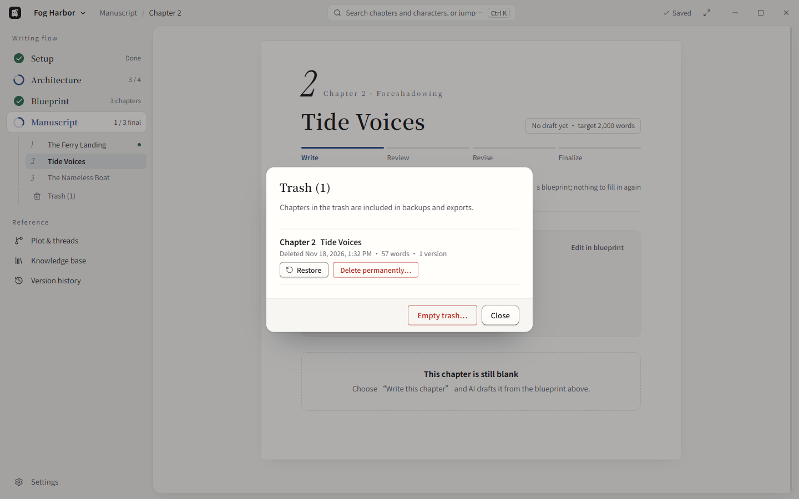

### Bilgi tabanı ve arama: yazarken referans materyal

- Referans materyali (.txt, .md) içe aktarın. Son bölümler son işleme sırasında bilgi tabanına gider.
- Bir gömme (embedding) modeliyle arama anlamsaldır. Gömme modeli Settings → Retrieval model altındaki modeldir. Hiçbiri ayarlanmamışsa ve varsayılan model gömmeleri destekliyorsa (hiçbir amacı kaydedilmemiş eski bir profil dahil), Pagekin varsayılan modeli kullanır. İkisi de yoksa arama yerel tam metin aramasıdır ve Çince sorgular yalnızca kelimelerin bir kısmını içeren pasajların da eşleşmesi için kelimelere bölünür.
- Settings → Retrieval model altında isteğe bağlı bir yeniden sıralama (reranking) modeli ekleyebilirsiniz. Arama daha sonra daha fazla pasaj toplar, bunları yeniden sıralar ve en alakalı olanları tutar. Yeniden sıralama başarısız olursa sonuçlar orijinal sırasını korur.
- Ortadan bir bölümü doldurduğunuzda, taslağın sonraki olay örgüsünü ödünç almaması için arama o bölümden veya daha sonraki bölümlerden son metin döndürmez.

### Çalışma sayfası: yapay zekanın ne yaptığını görün

Her üretim çalıştırması, In progress, History ve Diagnostics sekmeleriyle çalışma sayfasında görünür. Çıktıyı yazılırken izleyebilir ve istediğiniz zaman iptal edebilirsiniz. Bir toplu iş duraklatılabilir. Bir adım 15 saniye boyunca ilerleme kaydetmediğinde, kartı ne kadar süredir beklediğini gösterir.

Bir çalıştırma başarısız olursa, o ana kadar yazılan metin benimseyebileceğiniz, kopyalayabileceğiniz veya kapatabileceğiniz bir kurtarma kartı olarak tutulur. Pagekin arka plandayken yazma, inceleme, düzeltme, tamamlama veya toplu yazma bittiğinde bir sistem bildirimi gösterir. Bunu Settings → Appearance altında "Notify me in the background" ile kapatabilirsiniz.

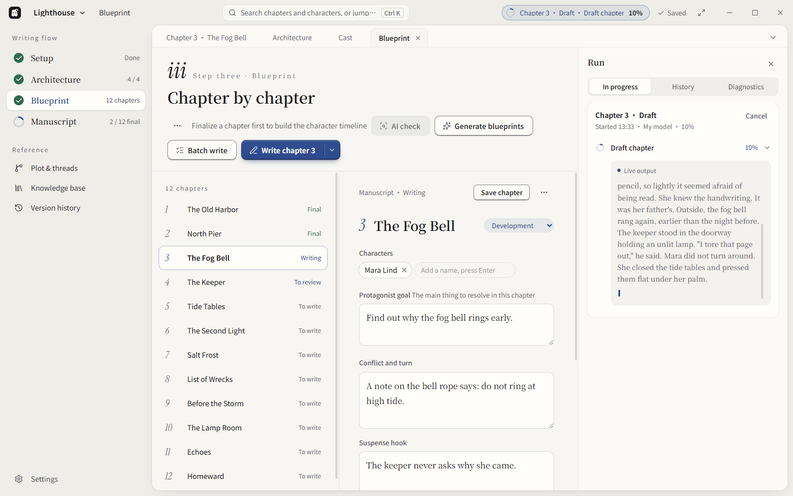

### Sürümler, dışa aktarma ve yedekleme

- **Sürüm geçmişi**: Bir bölümün her geçmiş sürümü saklanır. Geçerli taslakla karşılaştırın veya yeni bir taslak olarak geri yükleyin.
- **Dışa aktarma**: Birleştirilmiş Markdown, bölüm başına bir Markdown dosyası veya düz metin.
- **Yedekleme**: Bir kitabı bilgisayarınızda arşivleyin veya bağladığınız bir WebDAV bulutuna yedekleyin. Geri yükleme her zaman yeni bir kopya oluşturur.

### Yazım becerileri: kendi yazım kurallarınızı getirin

"Writing skills" ayarlar sayfasında yerel bir beceri klasörü veya tek bir SKILL.md seçin ya da yalnızca istem (prompt-only) içeren bir yazım becerisini — örneğin tipik yapay zeka tonunu ortadan kaldıran bir beceri veya belirli bir tarz ya da tür için bir beceri — içe aktarmak için GitHub'daki bir becerinin adresini girin. SKILL.md'nin alıntıladığı referans metin dosyaları dahil edilir. Uygulama beceriyi okur ve yüklemeden önce içeriğini size gösterir. Bunu planlama, yazma, inceleme veya düzeltme aşamasına bağlayın; o aşamadaki her üretim bunu içerir.

Yalnızca kendi kendine yeten SKILL.md istemleri desteklenir. Betikler, kancalar, alt ajanlar ve araç gereksinimleri yüklenmez, böylece bir beceri bilgisayarınızda kod çalıştıramaz.

### Koyu tema ve üç arayüz dili

Görünüm açık ve koyu sunar. Arayüz Çince, İngilizce ve Japonca dillerinde mevcuttur. Japonca arayüz 1. aşamadadır: arayüz çerçevesi ve hata mesajları Japoncadır ve diğer metinler İngilizce kalır. Bir kitabın yazım dili Çince veya İngilizce olabilir.

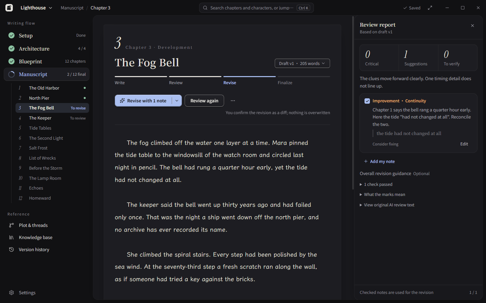

## Bir yapay zeka sohbetinde roman yazmaktan farkı nedir

Bir sohbet penceresinde uzun bir roman yazdığınızda, olağan sorunlar çelişkiler, unutulan öngörüler ve daha önceki bir bölümü düzenledikten sonra bozulan sonraki bölümlerdir. Pagekin bunu büyümeye devam eden bir konuşmada değil, kitabın verilerinde tutar.

- **Bağlam bölüm başına oluşturulur**: Her bölüm ihtiyaç duyduğu taslağı, karakterleri, dünya inşasını, önceki özetleri, önceki bölümü ve örgüleri alır. Tüm kitabın asla tek bir konuşmaya sığması gerekmez.
- **Karakter durumları bölümü izler**: N. bölüm, N. bölüm itibarıyla durumları ve ilişkileri kullanır; bu nedenle önceki bir bölümü doldurmak sonraki olayları sızdırmaz.
- **Örgülerin teslim tarihleri vardır**: Bu bölümün ele alması gereken örgüler isteme gider, inceleme bunları kontrol eder ve biri çözüldüğünde onaylarsınız.
- **Düzenlemeler bir etki listesiyle gelir**: Bir son metin değiştirilmeden önce Pagekin neleri etkilediğini listeler ve yapay zeka daha sonra yalnızca sonraki taslakları düzeltebilir.
- **Yapay zeka metninizin üzerine asla doğrudan yazmaz**: Düzeltmeler, açıklama düzenlemeleri, tahmin edilen ayarlar ve ilişki değişiklikleri kabul etmeniz için diff veya öneri olarak görünür.
- **Kitaplarınız yerel kalır ve modeli siz seçersiniz**: Veriler yerel bir SQLite veritabanında ve kitap klasörünüzde yaşar. Model bir bulut API'si veya yerel bir model olabilir.

## Desteklenen modeller ve hizmetler

Pagekin model sağlamaz veya kota barındırmaz. Ayarlarda kendi hizmet adresinizi, model adınızı ve API anahtarınızı girin. Üç istek protokolü desteklenir:

- **OpenAI-compatible**: Chat Completions API ile uyumlu herhangi bir hizmet.
- **Native Gemini**: Google Gemini.
- **Anthropic**: Zhipu'nun Anthropic uç noktası gibi Messages API ile uyumlu hizmetler.

Ayarlar bu sağlayıcılar için ön ayarlar içerir:

| Sağlayıcı | Protokol | Notlar |
| --- | --- | --- |
| DeepSeek | OpenAI-compatible | Ön ayar adresi `https://api.deepseek.com` |
| SiliconFlow | OpenAI-compatible | Ön ayar adresi `https://api.siliconflow.cn/v1` |
| BigModel (Zhipu) | OpenAI-compatible | Ön ayar adresi `https://open.bigmodel.cn/api/paas/v4` |
| BigModel (Zhipu Anthropic) | Anthropic | Ön ayar adresi `https://open.bigmodel.cn/api/anthropic` |
| OpenAI | OpenAI-compatible | Ön ayar adresi `https://api.openai.com` |
| xAI (Grok) | OpenAI-compatible | Ön ayar adresi `https://api.x.ai/v1` |
| Google Gemini | Native Gemini | Ön ayar adresi `https://generativelanguage.googleapis.com` |
| Ollama (yerel) | OpenAI-compatible | Model kendi bilgisayarınızda çalışır |
| NovelAI | OpenAI-compatible | Minimal uyumluluk, gerçek bir hesapla tam doğrulanmamış |
| Custom | Üçünden herhangi biri | Herhangi bir uyumlu hizmet adresi |

"Custom" yalnızca yukarıdaki üç protokol dahilinde adresi, model adını ve kimlik bilgilerini değiştirir. Rastgele bir HTTP arayüzü değildir. Azure, yerel KoboldAI ve benzeri arayüzler özel adaptörlere ihtiyaç duyar ve bir URL değişikliği bunları çalıştırmaz.

- **Model listesi**: Adresi ve API anahtarını girdikten sonra Pagekin uç noktanın model listesini getirir. Ayrıca yerel bir model dosya yolu dahil (örneğin llama.cpp ile) herhangi bir model adını yazabilirsiniz.
- **Bağlam penceresi**: Bir model seçtiğinizde, bağlam penceresi kaynağıyla birlikte (sağlayıcıdan, yerleşik verilerden, varsayılan, sizin tarafınızdan ayarlanmış veya ölçülmüş) dolar. Tek bir bölüm yazdığınızda ve sağlayıcı çok uzun olduğu için reddettiğinde, Pagekin hatadan gerçek pencereyi okuyabiliyorsa bir kez daha yazar. O pencereyi kaydeder ve önce referans materyali kırpar.
- **Aşamaya göre modeller**: Settings → Advanced → Models by stage altında planlama, yazma, inceleme, düzeltme ve son işleme için bir model atayın. Atanmayan aşamalar varsayılan modeli kullanır.
- **Geri getirme (Retrieval) modeli**: Bilgi tabanında anlamsal arama, gömmeleri (embeddings) destekleyen bir model gerektirir. Ayarlarda "Retrieval model" altında bir tane ayarlayabilirsiniz. Olmadan, gömmeleri destekleyen varsayılan bir model kullanılır. Yeniden sıralama modeli isteğe bağlıdır.

### Ollama ile yerel bir model çalıştırın

```text
Provider:  Ollama (local) or Custom
Protocol:  OpenAI-compatible
Base URL:  http://127.0.0.1:11434/v1
API key:   may be left blank; if the UI requires one, use any placeholder
Model:     your Ollama model name, for example qwen3:14b
```

Gömme modelleri de `/v1` adresini kullanır. Ollama'nın yerel arayüzü olan `http://127.0.0.1:11434/api` adresini kullanmayın.

## İndir ve yükle

Resmi yükleyicileri yalnızca [GitHub Releases](https://github.com/EthanYoQ/Pagekin/releases/latest) üzerinden indirin.

Sistem gereksinimleri: Windows x64 veya macOS (Apple Silicon ve Intel için ayrı yükleyiciler). Ayrıca bir model hizmetine ihtiyacınız vardır: bir bulut API anahtarı veya Ollama gibi yerel bir çıkarım hizmeti.

### Windows x64

```text
ai-novel-writer-setup-<version>.exe
```

1. Yükleyiciyi çalıştırın. Bir yükseltme yalnızca uygulamayı günceller ve kitapları, karakter kartlarını veya ayarları silmez. Yine de önemli çalışmalarınızı önce yedekleyin.
2. Kurulumdan sonra "Settings → About & updates" altından güncellemeleri kontrol edin. Önce yeni bir sürüm duyurulur. Yalnızca siz "Download update" seçtikten sonra indirilir ve bittiğinde şimdi veya daha sonra yeniden başlatmayı seçersiniz.
3. Eski taşınabilir ZIP derlemeleri güncelleyiciyi otomatik olarak alamaz. Resmi bir yükleyiciyi bir kez elle yükleyin.

Yükleyici şu anda kod imzalı değildir. Windows bilinmeyen yayıncı uyarısı gösterebilir. Yalnızca indirme sayfasının bu deponun resmi GitHub Release sayfası olduğunu doğruladıktan sonra devam edin.

### macOS (Apple Silicon ve Intel)

```text
ai-novel-writer-mac-arm64-<version>-installer.dmg
ai-novel-writer-mac-x64-<version>-installer.dmg
```

1. `arm64` Apple Silicon Mac'ler (M1, M2, M3, M4 ve sonrası) içindir. `x64` Intel Mac'ler içindir.
2. Uygulamayı DMG'den Applications'a sürükleyin ve başlatın. Uygulama yeni sürümleri duyurur ancak macOS'ta kendini indirmez veya değiştirmez. Güncelleme, mimariniz için yükleyiciyi indirebilmeniz için resmi Release sayfasını açar.
3. Her iki yükleyici de geçici (ad-hoc) imzalıdır, Developer ID imzasına sahip değildir ve noter onaylı (notarized) değildir. Gatekeeper uygulamayı engellerse, bu deponun resmi GitHub Release'inden geldiğini doğrulayın, ardından Finder'da uygulamaya Control-tıklayın ve "Open" seçin veya "System Settings → Privacy & Security" içinde izin verin.

## Veri ve gizlilik

| Veri veya davranış | Konum veya hedef |
| --- | --- |
| Kitaplar, karakterler, taslaklar, taslak metinler ve son bölümler | Kitap klasörünüz ve yerel bir SQLite veritabanı. |
| "Delete manuscript…" ile silinen tamamlanmış bölümler | Geçerli kitabın çöp kutusu. Kalıcı olarak silene kadar geri yükleyebilirsiniz. |
| Başarısız çalıştırmalardan kurtarma kartları | Yalnızca geçerli kitabın yerel veritabanında. Kendi başlarına asla taslak metin veya son bölüm olmazlar. |
| İçe aktarılan referans materyal | Yerel kitapta saklanır. Bir gömme modeliyle (geri dönüş olarak varsayılan model dahil), pasajları içe aktarma sırasında o modele gönderilir. |
| Yerel model istekleri | Yapılandırdığınız yerel veya LAN çıkarım hizmetine gönderilir. |
| Bulut model istekleri | İstemler ve bağlam seçtiğiniz sağlayıcıya gider. |
| Bilgi tabanı içe aktarma ve arama | Bir gömme modeliyle (geri dönüş olarak varsayılan model dahil), içe aktarılan materyalden ve son bölümlerden pasajlar ve arama sorguları o modele gider. Bir yeniden sıralama modeliyle, sorgular ve alınan pasajlar yeniden sıralama modeline gider. İkisi de olmadan arama yerel kalır. |
| Model ayarları ve API anahtarları | Uygulama veri dizininizin `ai-novel-writer` klasöründe saklanır (Windows'ta `%APPDATA%\ai-novel-writer`, macOS'ta `~/Library/Application Support/ai-novel-writer`). İşletim sistemi hesabınızı koruyun ve bu klasörü paylaşmayın. |
| Uygulama tercihleri | Model ayarlarıyla aynı klasörde saklanır. |

Önceki sürümler ayarları `~/.vela` içinde tutuyordu. Geçerli sürüm bunları başlangıçta yukarıdaki klasöre kopyalar ve orijinaline dokunmaz.

Uygulama model hesapları, bulut üretimi veya tanıtım mesajları sağlamaz. Güncelleme kontrolleri yalnızca herkese açık GitHub Releases'ı okur.

## SSS

### Pagekin ücretsiz mi?

Evet. GPL-3.0 lisansı altında açık kaynaklıdır. Bir bulut modelini çağırmanın herhangi bir maliyeti sizinle model sağlayıcısı arasındadır. Ollama aracılığıyla yerel bir model hiçbir sağlayıcı gerektirmez.

### Roman yazmak için hangi yapay zeka modellerini kullanabilirim?

DeepSeek, Qwen (SiliconFlow aracılığıyla), Zhipu GLM, OpenAI ve xAI Grok gibi OpenAI uyumlu Chat Completions API arkasındaki herhangi bir model çalışır. Google Gemini kendi yerel protokolünü, Zhipu'nun Anthropic uç noktası ise Anthropic protokolünü kullanır. Yerel modeller için Ollama kullanın. Çıktı kalitesi seçtiğiniz modele bağlıdır. Uygulama model çıktısı hakkında hiçbir söz vermez.

### Verilerim nerede saklanıyor? Yükleniyor mu?

Kendi bilgisayarınızda: kitap klasörü artı yerel bir SQLite veritabanı. Yazma, inceleme ve bir roman içe aktarmadan sonraki çözümleme ve son işleme gibi model kullanan işlemler ilgili metni, kurulumu ve bağlamı yapılandırdığınız model hizmetine gönderir. Bir gömme modeliyle (geri dönüş olarak varsayılan model dahil), bilgi tabanı içe aktarma materyalinizin pasajlarını ona gönderir ve arama sorguyu gönderir. Bir yeniden sıralama modeliyle, arama sorguyu ve alınan pasajları ona gönderir. Özel materyali yerel tutmak için, içe aktarmadan önce içe aktarmanın kullandığı her modeli yerel bir modele geçirin: varsayılan model, Models by stage altındaki herhangi bir model ve geri getirme ile yeniden sıralama modelleri. Hiçbir geri getirme modeli ayarlanmamışsa varsayılan model devreye girer. WebDAV yedeklemesi yalnızca WebDAV bağlayıp bir yedekleme başlattığınızda yükler.

### Çevrimdışı yazabilir miyim?

Evet, varsayılan model, Models by stage altındaki herhangi bir model ve geri getirme ile yeniden sıralama modelleri dahil kullandığınız her model bilgisayarınızda veya LAN'ınızdaysa. Güncelleme kontrolleri, GitHub'dan beceri içe aktarma, WebDAV yedekleme ve bulut modelleri ağ bağlantısı gerektirir.

### Bir roman ne kadar uzun olabilir? Tutarlı kalır mı?

Sabit bir sınır olmadan toplam bölüm sayısını siz belirlersiniz. Her bölüm için yapay zeka bölümün taslağını, ilgili karakterleri, dünya inşasını, önceki bölümlerin özetlerini, önceki bölümün tamamını ve ele alması gereken örgüleri alır; böylece tüm kitabın asla tek bir konuşmaya sığması gerekmez. Karakter durumları bölümü izler ve taslak yapay zeka kontrolü taslakları karakter zaman çizelgesiyle karşılaştırır. Toplu yazma çalıştırma başına en fazla 10 bölümü işler ve çalıştırma üstüne çalıştırma devam edebilirsiniz.

### Tamamlanmış bir bölümü düzenleyebilir miyim? Yanlış bölümü silersem ne olur?

Evet. Tamamlanmış bir bölümde "Reopen to edit" seçin. Tekrar tamamladığınızda, sürüm geçmişinde kalan eski son metnin yerini alır. "Delete manuscript…" ile silinen tamamlanmış bölümler çöp kutusuna gider ve bunları geri yükleyebilirsiniz.

### Zaten başladığım bir romanı içe aktarıp devam edebilir miyim?

Evet. Kütüphanede "Novel breakdown & imitation" açın, bir .txt, .md veya .epub dosyası içe aktarın ve "My manuscript" seçin. Bölümleriniz son metin olarak içe aktarılır, ayarlar, mimari, karakterler ve taslaklar bunlardan tahmin edilebilir ve bir sonraki bölümden devam edersiniz.

### İngilizce veya Japonca yazmayı destekliyor mu?

Bir kitabın yazım dili Çince veya İngilizce olabilir. Japonca yazım henüz desteklenmemektedir. Arayüz Çince, İngilizce ve Japonca dillerinde mevcuttur ve Japonca arayüz 1. aşamadadır.

### 1.5.x sürümüne nasıl yükseltirim?

1.1.0, 1.2.x, 1.3.x veya 1.4.x yüklüyse uygulama içi bir güncelleme bildirimi alırsınız (macOS'ta yeni yükleyiciyi elle indirin). 1.5.0 bir projeyi açtığında proje verilerini yükseltir. Bundan sonra 1.4.x ve öncesi projeyi açamaz veya 1.5.0'dan dışa aktarılan arşivleri geri yükleyemez, bu yüzden önemli kitapları önce yedekleyin. Eski bir sürümden bir proje için kütüphanede "Import" ve ardından "Import an old project copy" seçin. İçe aktarma yeni bir kopya oluşturur ve orijinal projeye dokunmaz. 1.5.3 bir projeyi açtığında proje verilerini de yükseltir. Bundan sonra 1.5.0 ve öncesi projeyi açamaz ve 1.5.3'ten dışa aktarılan arşivleri geri yükleyemez.

### Yapay zeka tonunu kaldıranlar gibi becerileri içe aktarabilir miyim?

Evet. "Writing skills" ayarlar sayfasında yerel bir beceri klasörü veya SKILL.md seçin ya da becerinin GitHub adresini girin, içeriğini inceleyin, yükleyin ve yazma veya düzeltme gibi bir aşamaya bağlayın. Yalnızca istem (prompt-only) SKILL.md dosyaları desteklenir. Hiçbir betik yüklenmez veya çalıştırılmaz.

### Asistan sohbeti nereye gitti?

1.3.0'da tanıtılan arayüz şimdilik asistan sohbeti girişini gizlemektedir. Ayrı olarak geri dönecektir. Yazma, inceleme, düzeltme ve iş akışının geri kalanı etkilenmez.

### Windows veya macOS yükleyicinin güvenli olmadığını söylüyor. Ne yapmalıyım?

Windows yükleyicisi imzasızdır ve Mac yükleyicileri yalnızca geçici (ad-hoc) imzalıdır ve Apple tarafından noter onaylı değildir, bu nedenle sistem sizi uyarır. Yükleyicinin bu deponun resmi GitHub Release'inden geldiğini doğruladıktan sonra izin vermek için "İndir ve yükle" altındaki adımları izleyin.

## Mevcut sınırlar

- Tek başına bir URL ve anahtar, herhangi bir üçüncü taraf API'nin çalışacağını garanti etmez. Yalnızca uygulanan üç protokol ve ön ayarlar desteklenir.
- Yazım dili Çince veya İngilizcedir. Japonca arayüz yalnızca arayüz çerçevesini ve hata mesajlarını çevirir.
- Uygulama yaratıcı yargınızın, doğruluk kontrolünüzün veya telif hakkı kararlarınızın yerini almaz. Yapay zekanın yazdığı her şeyi gözden geçirin.
- Çevrimiçi yayıncılık, okuma topluluğu veya bulut model hesapları sunmaz.

## Kaynaktan derleme

Node.js 22.15 veya üzeri ve depoda sabitlenmiş pnpm sürümüne ihtiyacınız vardır.

```sh
git clone https://github.com/EthanYoQ/Pagekin.git
cd Pagekin
pnpm install --frozen-lockfile
pnpm dev
```

Resmi yükleyiciler GitHub Actions'ta derlenir. Windows x64, macOS Apple Silicon ve macOS Intel yükleyicilerinin her biri tek bir GitHub Release'de listelenmeden önce kendi yeterliliğinden geçer. Belgeleme yetkisi, ADR'ler ve geliştirme kuralları için [`docs/README.md`](docs/README.md) dosyasına bakın. Logo, renkler ve tasarım dosyaları [marka kitinde](docs/brand/README.md) (Çince) dizinlenmiştir.

## Katkıda bulunma

Hataları bildirin ve [GitHub Issues](https://github.com/EthanYoQ/Pagekin/issues) üzerinden özellik isteyin ve kullanım sorularını [Discussions](https://github.com/EthanYoQ/Pagekin/discussions) içinde sorun. Bir pull request açmadan önce [CONTRIBUTING.md](CONTRIBUTING.md) dosyasını okuyun. Bu herkese açık bir depodur, bu nedenle gönderdiğiniz her şeyden API anahtarlarını, tam roman metinlerini ve yerel yolları kaldırın.

## DeepSeek Harness eklentisi (dondurulmuş)

Depo ayrıca DeepSeek Harness için bir Web eklentisi olan `@ethanyoq/dsh-ai-novel-writer` `0.1.0` geliştirici önizlemesini de tutar. Eklenti dondurulmuştur ve kısa vadede planlanmış bir özellik çalışması yoktur. Masaüstü uygulamasının yeteneklerinin %10'undan azına sahiptir, masaüstü projelerini okumaz ve masaüstü uygulamasının yerini almaz. MIT lisansı altında [npm](https://www.npmjs.com/package/@ethanyoq/dsh-ai-novel-writer) üzerinde ayrı olarak yayınlanır. Kurulum ve kullanım için [eklenti README](plugins/dsh-ai-novel-writer/README.md) dosyasına bakın.

## Lisans

Masaüstü uygulaması [GPL-3.0](LICENSE) lisansı altında açık kaynaklıdır.
